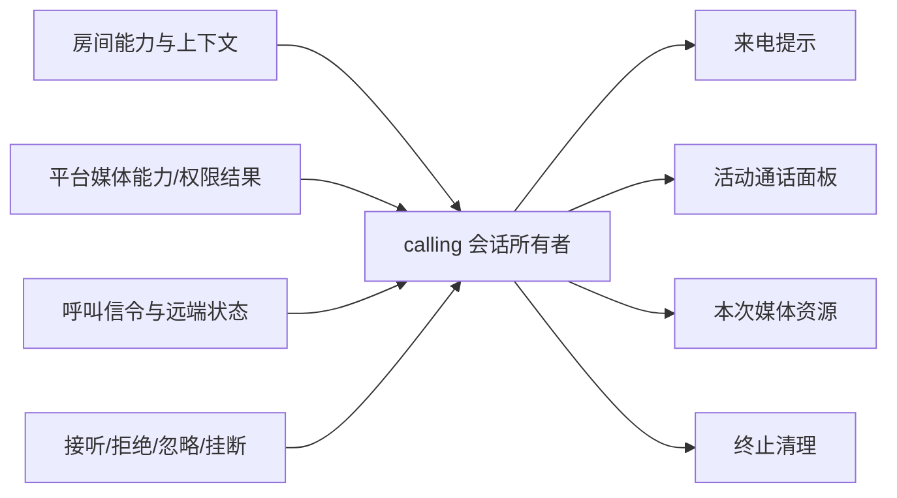

# 通话规格

**状态:** Draft（目标行为提案，未接线、未验证）
**版本:** 0.1（决策基线：D01–D03）
**受众:** 产品、实时媒体工程、测试与评审；按来电及通话操作核对可见结果和资源生命周期。
**范围:** 来电有效性、接听/拒绝/忽略、权限、呼叫建立、活动媒体、挂断与终止清理。
**治理:** 本规格只拥有通话会话与媒体生命周期。消息发送重试/事务见 [message-delivery §4](../message-delivery/spec.md#4-功能需求与接口契约)；房间成员和呼叫能力权限见 [rooms-spaces §4](../rooms-spaces/spec.md#4-功能需求与接口契约)；账户密钥和信任规则见 [session-security §4](../session-security/spec.md#4-功能需求与接口契约)；浏览器设备能力与权限提示/通知见 [web-platform §4](../web-platform/spec.md#4-功能需求与接口契约)。不复制这些域规则。Draft、Demo、空屏障均不是产品实现证据。
**变更历史:** 来电与活动通话路径由 `client-core/spec.md` 拆分；原图中相应新增通话分支属于作者提案，尚未由用户批准。

---

## 1. 背景与目标

### 1.0 设计图景

本图描述用户收到来电或主动发起通话后的可见行为。来电通知本身不得启动媒体采集。房间与平台提供能力视图，calling 拥有呼叫状态及已取得的媒体资源。

```text
用户在房间发起通话
|-- 房间及平台提供当前模式可用能力 -> calling 请求所需媒体权限并建立会话
|   |-- 权限获准且远端建立 -> 显示活动通话和媒体控制
|   |   |-- 用户挂断/远端结束 -> 停止采集与传输，释放资源，返回房间
|   |   +-- 连接中断 -> 保留可观察的断线状态；恢复成功回活动通话，失败终止并清理
|   |-- 用户在建立前取消 -> 停止呼叫并释放已取得资源，返回房间
|   +-- 权限拒绝、设备不可用或呼叫建立失败 -> 显示具体失败原因，停止呼叫并释放已取得资源
+-- 能力不可用 -> 显示不可用，不请求媒体

calling 收到当前账户的来电
|-- 来电仍有效，且未撤销或被其他设备处理 -> 显示呼叫来源；不采集媒体
|   |-- 用户私聊接听 -> 请求权限并建立媒体会话
|   |-- 用户私聊拒绝 -> 提交拒绝给呼叫服务
|   |   |-- 服务确认 -> 移除本机来电提示
|   |   +-- 服务拒绝/请求失败 -> 保留来电有效状态并显示错误；用户重试、接听或忽略
|   |-- 用户忽略群聊来电 -> 仅关闭本机提示，不终止群组通话
|   +-- 用户暂不操作 -> 保留有效提示，直到用户处理或来电失效
+-- 来电已过期、对端撤销或其他设备已处理 -> 移除/不展示可接听提示，不启动媒体

用户接听有效来电
|-- 权限获准且会话建立 -> 显示活动通话；媒体资源由 calling 持有
|-- 用户拒绝权限 -> 显示未接通原因，终止本呼叫并释放此前已取得资源；不采集被拒设备
|-- 用户在权限请求或建连中取消 -> 停止本呼叫，移除本次接听提示，进入终止清理并返回房间
|   +-- 迟到授权/建连结果返回 -> 仍归原呼叫所有者，立即停止并释放本次新增资源，不恢复活动态
+-- 对端撤销、来电过期或建立失败 -> 终止该呼叫，清理已取得资源并显示结果

用户处于活动通话并隐藏面板、切换房间或窗口布局
|-- 会话仍有效 -> 保持活动媒体与控制状态，提供可返回通话入口
+-- 用户明确挂断或服务端/远端结束 -> 停止媒体并释放资源；隐藏面板本身不挂断

用户在活动通话切换麦克风、摄像头、设备或屏幕共享
|-- 该操作无需新权限且会话有效 -> 按意图更新轨道，面板显示实际静音/摄像头状态
|-- 需要新增设备/共享权限 -> 平台请求用户授权
|   |-- 获准且新轨道建立 -> 更新本会话媒体与控制状态
|   +-- 拒绝/设备不可用/取消 -> 保留原可用媒体，显示原因，不声称共享开启
+-- 用户停止共享或系统结束共享 -> 停止共享轨道；其他通话媒体按原设置保持

用户结束或通话异常终止
|-- 结束确认 -> 停止采集/传输，关闭轨道与会话资源，显示已结束
+-- 清理过程遇到失败 -> 标记清理未完成并由资源所有者继续释放；不显示活动媒体仍可用
```

### 1.1 为什么写

来电提醒、权限请求与活动媒体是不同阶段。把它们合并会让实现者在提示来电时就开启麦克风，或在面板隐藏时错误挂断。明确生命周期所有权，使每个可达终止路径都有资源释放结果。

### 1.2 目标

- GOAL-1：仅有效来电可被接听；过期、撤销和其他设备处理的来电不启动媒体；见 AC-001。
- GOAL-2：接听和发起过程将权限/连接结果如实呈现，并在失败或取消时释放已取得资源；见 AC-002。
- GOAL-3：活动通话在面板隐藏、导航或布局变化时仍保持；明确结束才终止并清理；见 AC-003。

### 1.3 非目标（Out of Scope）

- 呼叫信令及协商由本域的 SDK 适配边界接收和归属，不手写未核验协议；密钥/用户与设备信任引用账户与安全域。
- 房间成员、呼叫模式可用性及服务端加入许可归 rooms-spaces。
- 通知授权、推送订阅与浏览器能力入口归 Web 平台；通话域请求并持有本次采集资源，消费平台的能力/权限结果。
- 消息投递重试规则不属于呼叫重连；消息发送事务不在本规格定义。
- 不将群组来电本机忽略描述为结束其他人的群组通话。

## 2. 术语表

| 术语 | 定义 | 禁止同义词 |
|---|---|---|
| 有效来电 | 当前账户收到且尚未过期、撤销或被其他设备处理的呼叫邀请 | 待处理消息 |
| 活动通话 | 已建立且媒体会话由 calling 持有的通话 | 来电提示 |
| 本机忽略 | 关闭此设备的群组来电提示，不向其他参与者终止通话 | 拒绝群呼 |
| 媒体资源 | 本次呼叫取得的本地采集设备、轨道及会话资源 | 浏览器缓存 |
| 终止清理 | 会话结束后停止采集/传输并释放本次拥有的资源 | 面板关闭 |

## 3. 系统模型与状态机

### 3.1 架构与边界



calling 拥有有效来电、呼叫阶段和活动媒体引用；界面只呈现只读状态并提交意图。平台服务提供能力/权限结果，房间服务提供房间能力，信令提供远端事实。图不指定媒体库、锁或信令协议。

| 组件 | 输入与用户意图 | 状态所有者 | 失败观察与接收方 |
|---|---|---|---|
| 来电服务 | 当前账户的邀请、撤销/到期/其他设备处理事实 | calling 拥有来电有效性 | 无效事件不创建可接听提示；提示层移除旧项 |
| 来电提示 | 有效邀请、来源、私聊/群聊类型；接听/拒绝/忽略 | calling 拥有邀请；提示仅有本地可见状态 | 拒绝失败显示错误；群组忽略只结束本地提示 |
| 呼叫控制器 | 房间能力、用户接听/发起/取消、远端状态 | calling 拥有呼叫阶段 | 权限/连接失败显示原因，转终止清理 |
| 媒体资源所有者 | 平台授权的本地轨道和会话 | calling 拥有本次取得资源 | 停止/释放失败报告清理未完成并继续归还资源 |
| 活动通话面板 | 只读呼叫状态；静音/摄像头/挂断意图 | calling 拥有媒体；面板只拥有呈现状态 | 隐藏/路由变化保留活动通话，不自行释放轨道 |

### 3.2 状态定义

本域未建立有限事件模型。图中对象为来电有效性、呼叫阶段及媒体资源的拥有/释放结果。来电过期、远端撤销、权限拒绝、取消及终止的后继以 §1.0 定义；未创建 Haskell 状态机，不宣称 G7 通过。

### 3.3 状态转换

执行 §1.0 的来电/主动呼叫路径：来电先验证有效性，再显示提示；接听后才申请权限和建立媒体会话；活动会话在明确结束或建立失败时进入清理。群组忽略只移除本地提示。此处不定义连接重试次数或发送重试语义。

### 3.4 外部输入域矩阵

| 可达输入 | 成功观察 | 失败/取消观察 | 裁决所有者 |
|---|---|---|---|
| 来电到达 | 有效来电显示提示，不采集媒体 | 过期/撤销/其他设备处理则移除提示 | calling 与信令事实提供者 |
| 私聊拒绝 | 确认后移除提示 | 拒绝失败保留邀请并报错 | 呼叫服务 |
| 群聊忽略 | 仅本地提示消失 | 不改变远端其他参与者通话 | calling |
| 接听/发起 | 权限与建立均成功后进入活动通话 | 权限、设备、连接失败或用户取消均终止并清理；迟到新增资源仍由原呼叫释放，不复活会话 | 平台服务交付能力/权限结果，calling 持有并释放资源 |
| 活动时隐藏面板 | 通话仍活动且可返回 | 无失败后继；明确挂断独立处理 | calling |
| 远端结束/用户挂断 | 停止并释放本次媒体资源 | 清理问题标记未完成并继续回收 | calling 资源所有者 |

## 4. 功能需求与接口契约

本域需求 ID 在域内唯一。平台权限与通知链路见 [web-platform §4](../web-platform/spec.md#4-功能需求与接口契约)，密钥及设备信任见 [session-security §4](../session-security/spec.md#4-功能需求与接口契约)。

- REQ-001 来电有效期与处理
  - **作为**收到来电的用户，**我希望**只看到仍有效的呼叫并选择接听/拒绝/忽略，**以便**不会处理已失效邀请。
  - **优先级:** P0
  - **契约:** calling 在呈现可接听提示前核对有效性；过期、对端撤销、其他设备已处理均移除提示且不得启动媒体。私聊拒绝需以服务确认作为成功观察；群组忽略只改变本机提示。
  - **验收标准:** Given 来电已由其他设备处理，When 该事件到达本设备，Then 不显示可接听状态且不申请媒体权限；Given 群聊来电被忽略，Then 其他参与者的通话不被终止。
- REQ-002 权限与通话建立
  - **作为**准备接听或呼叫的用户，**我希望**先看到平台能力和权限结果再进入通话，**以便**明确知道为何不能接通。
  - **优先级:** P0
  - **契约:** 只有当前呼叫仍有效且所需权限获准后才建立活动媒体会话；拒绝、取消或建立失败时停止呼叫并释放已取得资源。
  - **验收标准:** Given 用户拒绝麦克风权限，When 建立流程返回，Then 不存在活动采集并显示拒绝原因；Given 权限及远端建立成功，Then 显示活动通话控制。
- REQ-003 活动媒体与结束清理
  - **作为**活动通话用户，**我希望**隐藏面板或切换界面时通话继续，且挂断/远端结束后释放媒体，**以便**视图变化不误挂断且结束不会遗留采集。
  - **优先级:** P0
  - **契约:** calling 是本次媒体资源唯一所有者；面板隐藏不终止会话；每条明确终止或建连失败路径执行停止采集/传输与释放。
  - **验收标准:** Given 活动通话面板被隐藏，When 用户返回，Then 同一通话仍活动；Given 通话结束，Then 采集与传输停止、已持有资源被释放并显示结束状态。
- REQ-004 远端撤销与异步结果
  - **作为**通话用户，**我希望**撤销、过期或远端结束结果不被迟到回包覆盖，**以便**不会重新显示无效来电或复活已结束媒体。
  - **优先级:** P1
  - **契约:** 旧呼叫结果不得恢复已结束呼叫；资源释放归原 calling 会话所有者。
  - **验收标准:** Given 呼叫已终止，When 旧连接结果迟到，Then 不恢复活动状态或重启媒体。

## 5. 错误模型

错误分类为目标契约，不声称存在既有平台错误码。

| 类别 | 产生条件 | 用户观察 | 恢复责任 |
|---|---|---|---|
| 呼叫无效 | 来电过期、撤销或其他设备处理 | 不可接听提示移除 | calling 丢弃呼叫 |
| 拒绝未确认 | 服务拒绝或请求失败 | 保留有效提示并显示拒绝未完成 | 呼叫服务重试/用户改选；不假称已拒绝 |
| 权限拒绝/接听取消 | 浏览器拒绝所需媒体或用户停止接听建立 | 未接通、停止本呼叫并清理已取得资源；迟到资源不进入活动态 | calling 资源所有者清理，Web 平台呈现权限恢复入口 |
| 设备不可用 | 所需媒体设备不可获得 | 显示设备不可用，呼叫不进入活动态 | 平台能力所有者 |
| 建立失败 | 远端拒绝或连接未建立 | 显示原因，清理已取得资源 | calling 清理后终止 |
| 远端结束 | 远端关闭活动会话 | 显示已结束，停止本机媒体 | calling |
| 清理失败 | 释放本次资源未确认完成 | 标记清理未完成，不声称资源已释放 | calling 资源所有者继续回收并报告 |
| 迟到结果 | 已终止呼叫后旧响应返回 | 活动状态不复活 | calling 丢弃旧代结果 |

## 6. 非功能需求（NFR）

不从原聚合继承未批准/未测量的通话性能数值。当前无经用户批准的建立延迟、并发通话数或恢复预算；缺少运行证据，不宣称媒体质量或后台可用性。

- 生命周期：每个被本次呼叫取得的资源须有对应终止清理结果；关闭视图不是释放触发条件。
- 隐私：来电提示阶段不采集媒体；错误和日志不得包含媒体密钥、凭据或私人信令负载。
- 有界性：终止后不得继续由本呼叫发送媒体；没有媒体轨道或会话资源在清理结束后保持活动。

## 7. 异常与边界条件

| 场景 | 系统行为 | 可观察结果 | 测试锚点 |
|---|---|---|---|
| 来电提示后过期 | 移除来电，不启动权限请求 | 不可接听状态 | 未接线，未提供锚点 |
| 其他设备先接听 | 丢弃本机提示 | 不建立第二路媒体 | 未接线 |
| 群聊来电被忽略 | 仅关闭本机提示 | 其他用户通话继续 | 未接线 |
| 接听中对端撤销 | 停止建立并清理已取资源 | 显示呼叫已取消 | 未接线 |
| 权限获准后远端建立失败 | 停止并释放轨道 | 显示连接失败 | 未接线 |
| 活动通话时切换房间/隐藏面板 | 保持呼叫状态和媒体 | 可返回活动面板 | 未接线 |
| 结束后旧响应迟到 | 不复活会话，不新增媒体 | 仍为已结束 | 未接线 |
| 轨道释放未确认 | 保留清理未完成状态并继续资源归还 | 不误报清理成功 | 未接线 |

## 8. 验收标准

- AC-001 / 来电处理：测试有效、过期、对端撤销和其他设备处理四种来电结果；群聊忽略不影响远端群呼，私聊拒绝只有确认后才显示完成。
- AC-002 / 权限建连：覆盖发起/接听、平台能力缺失、权限拒绝、设备缺失、用户取消、远端拒绝和连接失败；取消/拒绝清理此前已取得资源，迟到授权/建连新增资源由原呼叫释放，不复活会话。
- AC-003 / 活动媒体：隐藏/路由变化保持通话；静音/摄像头显示实际状态；共享拒绝保留原媒体、停止共享只结束共享轨道；结束/失败/取消有停止和释放结果。
- AC-004 / 迟到结果：终止后注入迟到结果不得恢复呼叫或媒体资源。
- AC-005：Demo 展示或模拟来电不能作为真实信令、权限、设备采集或远端终止实现证据。

## 9. 决策日志

| ID | 决策及来源 | 主要影响章节 | 验证规则 |
|---|---|---|---|
| D01 | 原聚合已确认的账户—会话—回复—发送关键路径不延伸定义通话；发送事务由 message-delivery 所有 | §1、§3–§8 | 通话文档不重定义消息发送重试/事务 |
| D02 | 原聚合的通话能力目标包含来电、活动媒体与终止释放；本次操作细节仍属待审作者提案 | §1–§8 | 以用户审阅为准，Draft 不表示已批准或已接线 |
| D03 | 来电无效条件、群组本机忽略、异步迟到处理和清理契约为作者提出的生命周期规则 | §1、§3–§8 | 逐条覆盖成功/失败/终止边界；缺少实机证据不宣称通过 |

## 10. 验证

- 本域无 Haskell 有限事件模型，未建立机械语义，不宣称 G7 通过。
- 本域 `tools/` 包含结构审计、负例与屏障；实际结果见 tools/README.md。无真实协议锚点，空屏障是 SKIP，不是产品通过。
- 产品代码、真实 Matrix 信令、浏览器媒体采集及设备清理均未验证；本规格保持 Draft。
