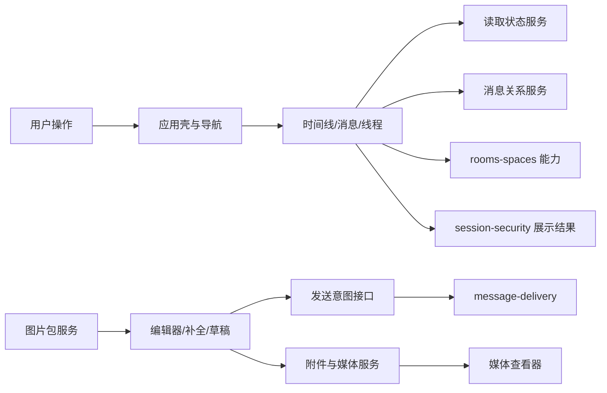

# 会话交互规格

**状态:** Draft（目标行为提案，未接线、未验证）
**版本:** 0.2（D04 确定关系动作提交归属）
**受众:** 产品、界面与领域工程、测试和评审；按操作路径确认用户可见结果与责任边界。
**范围:** 应用壳、会话导航、时间线/读状态、消息关系与线程、编辑/补全、草稿/回复/附件选择、图片包及媒体查看。
**治理:** 本规格是 conversation-ui 域的目标行为来源。变更先更新 §1.0，再在 §9 归因；正式发送事务引用[消息发送](../message-delivery/spec.md#4-功能需求与接口契约)，成员与权限引用[房间与空间](../rooms-spaces/spec.md#4-功能需求与接口契约)，密钥信任与恢复引用[账户与安全](../session-security/spec.md#4-功能需求与接口契约)。Draft、Demo、空屏障均非产品完整性证据。
**变更历史:** 本域从 `client-core/spec.md` 原有设计图与操作契约拆分；新补图中只有账户入口—会话阅读—回复草稿—发送路径属于用户已确认关键路径，其余为作者提案。

---

## 1. 背景与目标

### 1.0 设计图景

以下目标从已配置账户的会话视图开始。布局变化不改变会话或草稿归属。发送提交之后由 message-delivery 拥有事务、重试、取消及结果确认。

```text
用户打开会话列表并选择房间
|-- 房间可见且历史加载成功 -> 显示时间线、消息和阅读锚点
|-- 历史加载失败且已有缓存 -> 显示缓存、缺口与错误；用户重试或继续读缓存
|-- 历史加载失败且无缓存 -> 显示加载错误；用户重试或返回列表
+-- 当前身份不能访问 -> 显示房间服务给出的成员/访问结果；禁止进入可发送编辑态

时间线服务展示收到的消息内容
|-- 已撤回 -> 显示撤回占位，不继续展示原内容
|-- 明文或解密成功 -> 安全渲染内容、发送者和确认状态，不执行消息携带脚本
|-- 缺少密钥 -> 显示无法解密占位；用户可打开账户与安全域的恢复入口，恢复结果回到原消息
|-- 解密/校验失败 -> 显示失败原因与重试入口，不伪造明文
+-- 未识别的事件 -> 显示安全占位或结构化信息，不执行未知内容

用户搜索会话、消息或日期/事件位置
|-- 允许搜索且所选范围已有可检索数据 -> 显示匹配结果；选择结果进入上述定位路径
|-- 范围可检索且无匹配 -> 明确显示该范围无匹配
|-- 加密历史未在本地覆盖 -> 显示已索引范围与缺口，不把未覆盖称作无结果
+-- 查询失败或用户取消 -> 保留当前时间线；用户重试或返回

用户在时间线滚动、分页或从链接/搜索结果定位
|-- 目标窗口可读 -> 显示目标上下文并保留原阅读锚点供返回
|-- 分页或定位失败 -> 保留原窗口与锚点，显示失败及重试/返回
+-- 页面后台、消息未实际可见或上下文已切换 -> 不产生该消息的阅读意图

用户阅读前台实际可见消息
|-- 账户、房间及主时间线/线程作用域仍匹配 -> 读取状态服务更新本地位置并按隐私设置提交允许的回执
|   |-- 服务端确认 -> 显示确认位置，不声称对方已读
|   +-- 离线或失败 -> 保留本地阅读位置，标记同步未完成
+-- 作用域或可见性检查失败 -> 不推进阅读位置

用户回复、编辑、反应、撤回、置顶或打开线程
|-- 回复 -> 将目标标识及可安全显示摘要放进当前作用域草稿
|-- 编辑 -> 为目标消息建立独立编辑草稿；原消息保持最后确认内容
|   |-- 用户取消且尚未提交 -> 丢弃本次编辑草稿，原消息不变；本次编辑结束
|   +-- 用户保存 -> 会话关系服务接管编辑目标与候选内容，检查当前能力后使用 SDK 提交
|       |-- 对应修改获确认且关系投影有效 -> 显示确认后的编辑结果，结束本次编辑
|       |-- 输入无效、目标不可编辑或明确拒绝 -> 保留编辑草稿与原确认内容，显示原因；用户修改重试或取消
|       +-- 已提交后断线/超时而结果不明 -> 显示修改待确认，保留原确认内容和候选快照
|           |-- SDK同步确认对应修改 -> 显示确认后的编辑结果；本次保存结束
|           |-- 仍需重试 -> 关系服务核验原操作后重试，不变成新消息；回到保存结果判断
|           +-- 用户关闭编辑 -> 停止本地等待，保留未确认提示；迟到结果仍由关系服务消费，不承诺撤回修改
|-- 反应/撤回/置顶 -> 会话关系服务检查权限，按操作类型与固定目标通过 SDK 提交
|   |-- 确认 -> 更新对应关系或房间置顶确认视图；本次操作结束
|   |-- 明确拒绝/未提交的失败 -> 保持最后确认表现，显示原因；用户重试或返回
|   +-- 已提交结果不明 -> 显示待确认，不假称成功；读取对应事件关系/置顶状态后再判断，用户可停止本地等待
+-- 打开线程 -> 读取线程根和可见窗口；成功时使用独立草稿/读状态，失败不损伤主时间线

用户在编辑器输入、格式化、使用补全或粘贴
|-- 文档有效 -> 保存当前账户/房间/线程作用域草稿，保留选区与撤销历史
|   |-- 保存成功 -> 确认本次内容归属；补全仅在用户选中后插入并继续编辑
|   |-- 保存失败 -> 保留内存内容，显示未保存；离开前告知关闭将丢失未保存内容
|   +-- 用户切换会话/布局 -> 原草稿留在原作用域，回来时恢复
|-- 输入法仍在组合或补全未确认 -> 只编辑草稿，不触发发送
+-- 粘贴含不安全结构或不支持格式 -> 删除可执行结构与不支持格式，说明变化并保留安全文本

用户选择回复上下文、附件或图片包条目
|-- 回复目标被撤回/不再可展示 -> 保留目标标识，将摘要替换为占位
|-- 用户选择附件 -> 媒体服务读取文件并核对能力约束
|   |-- 可读且符合类型/大小约束 -> 加入当前草稿附件选择
|   +-- 不可读或约束失败 -> 显示具体文件错误，保留其他正文和附件
|-- 用户打开图片包并选择条目 -> 图片包服务读取目录与条目
|   |-- 可读且条目已选 -> 插入内容或交给附件选择
|   +-- 读取失败/面板关闭 -> 不插入，保留草稿
+-- 用户移除选择项 -> 仅从当前草稿移除，不改变已确认消息

用户点击发送或在非输入法组合态按发送快捷键
|-- 没有可发送正文或附件 -> 不清空草稿，焦点留在编辑器
|-- 当前身份/房间权限不允许 -> 显示原因并保留草稿
+-- 提交条件成立 -> 将提交意图和当前内容交给 message-delivery；本域不规定入队、重试、取消、未知结果或合并

用户打开图片、媒体或消息附件
|-- 鉴权、下载、校验及适用的解密成功 -> 查看器展示内容或保存入口
|   +-- 用户关闭 -> 释放本查看器不再使用的资源租约并返回原消息锚点
+-- 任一阶段失败 -> 说明失败阶段，不泄露凭据；用户重试或关闭

用户在会话中打开详情/设置/线程后返回，或改变视口宽度
|-- 次级视图打开 -> 记录会话和阅读位置，显示可达焦点
|-- 用户返回/Escape -> 关闭对应临时层并恢复原视图与焦点
+-- 窄屏/宽屏切换 -> 调整列与面板形态；保留账户、房间、筛选、草稿和当前任务
```

### 1.1 为什么写

原聚合规格将会话界面与认证、房间参与、发送及平台规则并列，维护者无法判断哪一域拥有读位置、草稿和消息动作。本规格将用户操作与本域状态所有权分开，并以跨域接口交接事务、身份和成员能力。

### 1.2 目标

- GOAL-1：用户可在响应式布局下浏览、定位和返回消息而不丢失上下文；见 AC-001、AC-002。
- GOAL-2：草稿、引用、线程、附件选择及编辑状态按账户和会话作用域保存，提交只表达意图；见 AC-003、AC-004。
- GOAL-3：消息关系、图片包和媒体结果仅显示服务所有者确认的状态；见 AC-005、AC-006。

### 1.3 非目标（Out of Scope）

- 发送快照、稳定事务、离线队列、重试次数/退避、取消后继、未知结果和事件回显归 message-delivery。
- 房间成员关系、可见性、成员权限及加入行为归 rooms-spaces。
- 密钥、身份认证、信任标记、加密内容的密钥恢复归 session-security；本域只消费安全展示结果。
- 浏览器配额、跨标签协调、推送、通知投递、PWA 更新及设备偏好归 web-platform。
- 本规格不声明现有 Demo 或代码已实现产品行为；不要求某一 UI 框架或具体组件目录。

## 2. 术语表

| 术语 | 定义 | 禁止同义词 |
|---|---|---|
| 阅读锚点 | 当前时间线中供恢复浏览位置的消息及其视图位置 | 已读回执 |
| 阅读作用域 | 账户、房间及主时间线或线程的组合 | 全局已读 |
| 草稿作用域 | 账户、房间及当前主会话/线程上下文 | 账户共享草稿 |
| 附件选择 | 用户选入当前草稿、尚未交给发送域的文件/媒体 | 待发送项 |
| 确认关系 | 服务端或关系服务确认的编辑、反应、撤回、置顶结果 | 乐观成功 |
| 发送意图 | 用户提交当前草稿的请求 | 发送事务 |

## 3. 系统模型与状态机

### 3.1 架构与边界



本域消费只读视图并发出用户意图。界面不裁决协议、权限、密钥信任或发送重试。组件不是对现有代码模块的断言。

| 组件 | 输入与用户意图 | 状态所有者 | 失败观察与接收方 |
|---|---|---|---|
| 应用壳与导航 | 账户、会话、视口；选择、返回、打开次级页 | 导航持有路由、焦点和返回锚点 | 页面失败保留原路由；交由用户重试/返回 |
| 时间线与消息 | 可见窗口、锚点、安全内容；分页、定位、阅读 | 时间线服务持有事件窗口；视图持有锚点 | 保留原窗口、显示缺口/错误；交给历史服务重试 |
| 读取状态接头 | 实际可见消息和隐私设置 | 读取状态服务持有作用域位置 | 同步失败标记未完成，不声称对方已读 |
| 消息动作与线程面板 | 账户/房间/目标消息/操作类型与候选内容；保存编辑、反应、撤回、置顶、打开线程 | 本域关系服务持有操作快照与结果、独立编辑草稿及确认关系；线程服务持有线程窗口 | 拒绝保留原确认值/编辑草稿；未知保留操作身份并核验结果，不交普通发送队列 |
| 编辑器与补全 | 草稿文档、输入事件；格式化、补全、粘贴 | 草稿服务持有内容；编辑器持有选区/撤销状态 | 保存失败保留内存内容并提示关闭损失风险；通知用户 |
| 附件选择与图片包面板 | 文件、包目录、当前草稿；添加/移除/选择 | 媒体服务持有资源任务；草稿服务持有选择引用 | 单项失败，不丢其余内容；交给用户移除或重选 |
| 媒体查看器 | 已授权资源与解密/格式状态；查看/保存/关闭 | 媒体服务持有资源租约 | 显示阶段错误；关闭时释放本查看器的租约 |
| 搜索面板 | 查询、范围、索引覆盖；检索/选择结果 | 搜索服务持有范围/索引状态，导航持有定位 | 区分无匹配、未覆盖与失败；不改变原时间线 |

### 3.2 状态定义

本域未建立有限事件模型。其主要对象为当前路由/锚点、作用域草稿、附件选择及查看器资源租约；它们由 §1.0 的用户操作路径规定。不可把本节对象清单解释为 Haskell 状态机或性质门通过证据。

### 3.3 状态转换

按 §1.0 的路径分支执行；时间线错误保留当前可见窗口，草稿错误保留内存中内容，动作错误回到最后确认状态。提交发送时仅交接内容与意图；正式结果引用 [message-delivery §4](../message-delivery/spec.md#4-功能需求与接口契约)。未生成状态图或机械模型。

### 3.4 外部输入域矩阵

| 用户可达输入 | 成功结果 | 失败/取消结果 | 裁决所有者 |
|---|---|---|---|
| 加载、分页或定位 | 更新窗口并保持/记录锚点 | 保留原窗口并显示错误 | 历史/同步服务 |
| 可见消息阅读 | 更新本地位置并按设置提交回执 | 保留本地位置并标记未同步；不可见时不更新 | 读取状态服务 |
| 编辑、补全、粘贴 | 更新作用域草稿 | 保留安全内容，说明被拒格式/保存错误 | 草稿服务与编辑器 |
| 附件/图片包选择 | 将合法选择关联当前草稿 | 单项报错，不清其他选择 | 媒体/图片包服务 |
| 消息关系动作 | 按类型和固定目标显示有效确认关系/置顶状态 | 拒绝保留原确认值和独立编辑草稿；提交后未知保持待确认，关闭不撤回 | 本域关系服务直接消费 SDK 结果，不走普通新消息队列 |
| 媒体查看 | 展示经校验内容 | 阶段错误，关闭可返回原锚点 | 媒体服务 |
| 发送提交 | 仅交接用户意图 | 空草稿不提交；权限错误保留内容 | 本域检查输入，message-delivery 拥有事务 |

## 4. 功能需求与接口契约

需求编号仅在本域唯一。发送处理详情见 [message-delivery §4](../message-delivery/spec.md#4-功能需求与接口契约)；身份/密钥及房间能力按上文跨域引用，不在此重述。

- REQ-001 响应导航与阅读上下文
  - **作为**正在阅读的用户，**我希望**切换布局、打开次级页后仍能返回原会话位置，**以便**继续当前任务。
  - **优先级:** P0
  - **契约:** 导航接收账户/房间/返回位置和视口变化；导航拥有路由及焦点，时间线拥有消息窗口，视图拥有阅读锚点。
  - **验收标准:** Given 用户在某房间阅读并打开详情，When 返回或视口改变，Then 恢复房间与可达焦点且草稿/锚点不变；Given 历史加载失败，Then 原窗口仍可读并显示错误。
- REQ-002 时间线与读取位置
  - **作为**读者，**我希望**定位目标消息并让真实可见内容更新我的阅读位置，**以便**阅读与隐私状态不被预加载误改。
  - **优先级:** P0
  - **契约:** 只有账户、房间、主/线程作用域仍匹配且消息前台实际可见时，才向读取状态服务提交意图；回执确认不表示对方已读。
  - **验收标准:** Given 用户定位到可访问消息，When 打开目标上下文，Then 能返回原锚点；Given 页面后台或已切换上下文，When 旧窗口加载完成，Then 不推进当前阅读位置。
- REQ-003 编辑器、补全及草稿
  - **作为**用户，**我希望**编辑富文本、使用补全并保留会话草稿，**以便**跨布局/会话切换继续撰写。
  - **优先级:** P0
  - **契约:** 草稿服务按账户、房间和线程作用域保存内容；编辑器管理选区/撤销；补全只有用户确认后插入。复用编辑动作不意味着创建消息。
  - **验收标准:** Given 输入法仍在组合，When 发送快捷键出现，Then 不提交且保留编辑内容；Given 草稿保存失败，When 用户离开，Then 先明确告知未保存风险。
- REQ-004 回复与附件选择
  - **作为**用户，**我希望**为草稿引用消息并选择附件，**以便**提交前核对上下文和文件。
  - **优先级:** P0
  - **契约:** 引用与附件属于草稿作用域；目标撤回时保留目标标识并替换安全摘要；单个附件失败不得清除其他内容。点击提交仅交接给 message-delivery。
  - **验收标准:** Given 一项附件读取失败而其他附件已准备，When 失败返回，Then 仅该项标错误且正文/其他附件仍在；Given 用户取消回复，Then 仅移除引用。
- REQ-005 消息关系与线程
  - **作为**用户，**我希望**管理自己有权操作的消息或打开线程，**以便**看见服务确认的关系并保留主时间线位置。
  - **优先级:** P1
  - **契约（D04）:** 会话关系服务是编辑、反应、撤回、置顶操作及其结果的唯一消费者，直接使用 SDK，不进入普通新消息队列。目标输入明确区分操作类型、账户、房间、目标消息、适用线程及候选值；输出区分未提交拒绝、已提交待确认、确认结果。编辑草稿归该关系操作，不覆盖普通草稿；只有有效关系确认才更新原消息投影。权限消费房间域能力，密钥规则消费安全域，不由关系服务重新定义。
  - **重试边界（D04）:** 事件类修改沿用 SDK 对应操作的稳定事务身份；置顶是房间状态写入，不套用普通消息事务语义，结果未知先重读当前置顶状态，不自动重放旧集合。关闭面板不是撤回提交，迟到结果仍归原操作消费者。
  - **验收标准:** Given 保存编辑明确拒绝，When 响应到达，Then 原确认内容和编辑草稿都保留；Given 已提交结果未知，Then 不创建新消息且不假称修改完成；Given 对应修改后来获确认，Then 关系投影更新原消息。反应/撤回/置顶分别核对目标、确认/拒绝/未知，线程不可读不改变主时间线锚点。
- REQ-006 图片包与媒体查看
  - **作为**用户，**我希望**选择图片包条目并查看媒体，**以便**在不执行不可信内容的情况下消费附件。
  - **优先级:** P1
  - **契约:** 只展示经媒体服务授权、校验及适用解密的内容；关闭查看器释放本组件不再需要的资源租约。
  - **验收标准:** Given 媒体校验或解密失败，When 查看失败，Then 显示失败阶段且不泄露凭据；Given 用户关闭查看器，Then 返回原消息锚点。

## 5. 错误模型

这些是目标错误类别，不是现有代码错误码。

| 类别 | 产生条件 | 用户观察 | 恢复/接收方 |
|---|---|---|---|
| 历史不可用 | 分页/定位请求失败 | 缓存缺口与错误，不显示为无消息 | 历史服务重试或返回 |
| 上下文过期 | 账户、房间或作用域切换后旧结果返回 | 不替换新上下文 | 导航/视图丢弃旧结果 |
| 草稿未保存 | 持久化写入失败 | 内存文档保留，明确关闭损失风险 | 草稿服务重试，用户决定离开 |
| 输入拒绝 | 不安全格式、无效补全或组合输入 | 安全文本保留，解释未插入/未提交 | 编辑器继续编辑 |
| 附件局部失败 | 单文件不可读或不符合能力 | 只标记失败项 | 用户重选/移除；其余附件归属保持 |
| 关系拒绝 | 服务端权限/状态拒绝动作 | 恢复最后确认关系 | 关系服务呈现原因 |
| 关系结果未知 | 编辑/反应/撤回/置顶提交后超时或断线 | 保留原确认值与候选操作，显示待确认 | 本域关系服务核验对应关系/状态；不交普通发送队列，不盲目重放置顶状态 |
| 媒体失败 | 授权、网络、校验、解密、格式任一失败 | 指明失败阶段，不显示伪内容 | 媒体服务重试或关闭释放资源 |
| 发送交接拒绝 | 空草稿或发送权限不足 | 不清草稿、不生成本地已发送项 | 本域保留草稿；事务后继归 message-delivery |

## 6. 非功能需求（NFR）

下列原聚合中的拟议预算未经批准、未测量；它们不是现有产品性能数据。只有 §6 适用的界面预算列于本域，不复制存储、推送或发送队列阈值。

| 指标 | 拟议值（未批准、未测量） | 边界 |
|---|---:|---|
| 冷启动至可交互 | 本地 Demo P95 ≤ 2.0 s；在线版本 P95 ≤ 3.0 s | 100 次启动及固定设备/账户环境；Demo 不证明在线能力 |
| 列表帧耗时 | P95 ≤ 18.2 ms | 60 Hz、500 条混合消息、连续 30 s；按帧耗时测量，不用 P95 fps |
| 首批消息展示 | 缓存命中 P95 ≤ 300 ms；在线 P95 ≤ 2.0 s | 100 次固定环境请求 |
| 并发视图工作 | 最多 4 个活动房间视图任务 | 超出时排队，不无界并发 |
| 响应式状态 | 360–1440 CSS px 范围内保留账户/房间/草稿/锚点 | 视口变化前后比较同一会话 |

安全要求：不可信消息内容不得作为可执行 HTML；读取密钥和信任状态只消费 session-security 的安全展示结果；本域日志不写令牌或密钥。

## 7. 异常与边界条件

| 场景 | 系统行为 | 可观察结果 | 测试锚点 |
|---|---|---|---|
| 账户 A 的迟到历史结果在切换到 B 后返回 | 不覆盖 B 视图/草稿 | B 当前上下文不变 | 未接线，未提供锚点 |
| 页面隐藏时旧窗口加载完成 | 不推进阅读位置 | 当前位置不变 | 未接线，未提供锚点 |
| 输入法组合时按发送快捷键 | 不提交 | 草稿内容保留 | 未接线，目标契约 |
| 回复目标撤回 | 保留标识，摘要替换占位 | 回复草稿可继续编辑 | 未接线 |
| 查看器下载/校验失败后关闭 | 释放查看器不再使用的租约 | 返回原消息位置 | 未接线 |
| 视口变窄且打开线程 | 保持线程作用域及可返回锚点 | 窄屏仍可操作导航 | 未接线 |

## 8. 验收标准

- AC-001 / 响应导航：加载/分页/定位失败保留旧窗口；切换布局或次级视图后返回原账户、会话和焦点。
- AC-002 / 时间线读取：核对明文、撤回、缺钥、校验失败、未知事件；搜索区分无匹配、未覆盖与失败；前台可见、后台、预加载、线程与上下文切换只按真实阅读提交回执。
- AC-003 / 编辑草稿：格式、补全确认、输入法组合、草稿切换、持久化失败和未保存离开警告遵从图示后继。
- AC-004 / 回复附件：回复取消/目标撤回、附件逐项失败、提交空草稿与权限拒绝均不丢失无关草稿内容；事务后继引用消息发送规格。
- AC-005 / 消息关系：保存编辑确认后更新原消息，拒绝保留编辑草稿，未知不新建消息；反应/撤回/置顶分别核对固定目标与确认/拒绝/未知，关闭面板后迟到结果仍归原操作；线程不可访问不改变原锚点。
- AC-006 / 图片包媒体：图片包不可读不插入内容；媒体失败分阶段可见，关闭返回原锚点并结束本查看器资源使用。
- AC-007：Demo 只证明其实际交互样例，不能作为上述产品能力或 Matrix 互操作的实现证据。

## 9. 决策日志

| ID | 决策及来源 | 主要影响章节 | 验证规则 |
|---|---|---|---|
| D01 | 原有账户入口—会话阅读—回复草稿—普通新消息发送路径为用户确认的关键路径；普通新消息事务后继委托消息发送域 | §1、§3–§8 | 对照设计图；界面不得接管普通新消息重试或结果确认；关系操作归属由本域单独定义 |
| D02 | 用户要求多端响应式与 Cinny v4.12.8 功能下限；界面状态与操作边界按此拆出 | §1–§8 | 逐项操作必须有明确状态所有者；功能对齐仍待证据 |
| D03 | 时间线增强、私有/线程读状态、富文本补全、附件选择、关系动作、图片包及媒体查看的分支与数值均为作者提案 | §1–§8 | 用户审阅前不升级为已确认范围；无实测不宣称性能达标 |
| D04 | 用户经 ask 选择：会话关系服务持有编辑/反应/撤回/置顶操作并直接使用 SDK，普通新消息单独交给消息发送域；本次补齐保存/拒绝/未知/取消路径 | §1.0、§3、§4、§5、§8 | 操作类型及目标固定；失败保留独立编辑草稿，不误发新消息；SDK映射尚待核验 |

## 10. 验证

- 状态保持 Draft；本域无 Haskell 有限事件模型，未建立机械语义，不宣称 G7 通过。
- 本域 `tools/` 包含结构审计、负例与屏障；实际结果见 tools/README.md。无真实协议锚点，空屏障是 SKIP，不是产品通过。
- 适用的跨域行为以 §1 和 §4 的链接为准；链接目标规格由其所有者提供。
- Cinny 功能下限及 Matrix 产品/协议对标仍未闭环：`issues/2026-11-16-产品与协议核验.md` 保持 open；该调查不作为删减本域功能的依据。
