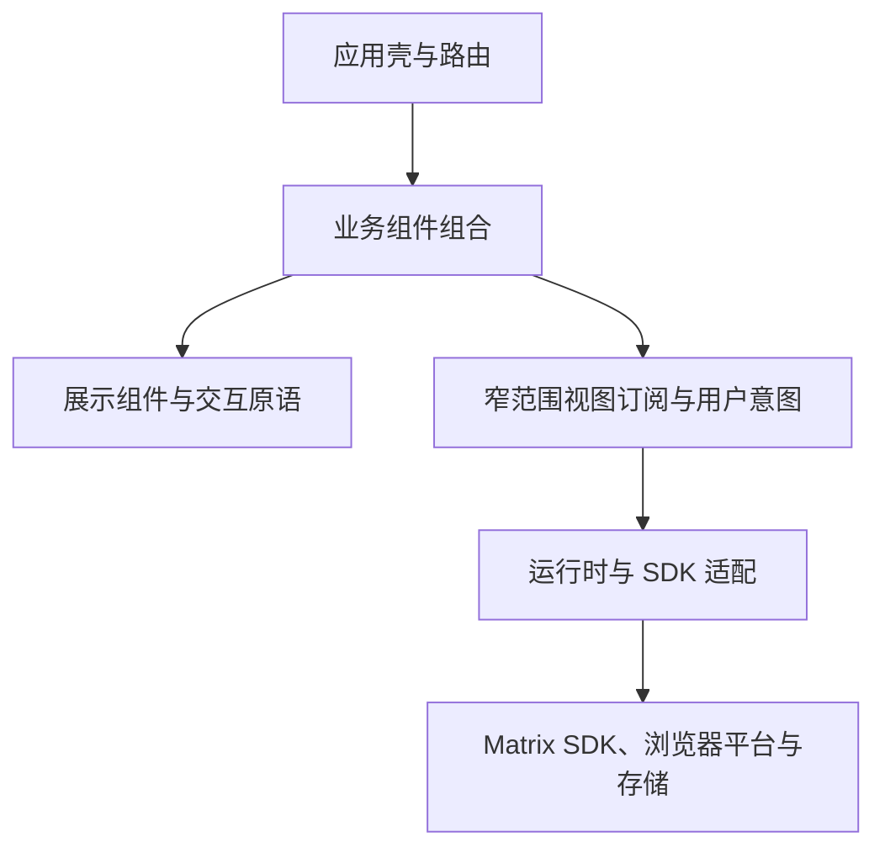

# Mirth 组件化核心规格

状态：待用户审阅的架构草案。组织方向已确认，具体契约尚未批准实施。

调查依据：[客户端核心规格调查](../research/客户端核心规格调查.md)。本文不表示代码已经存在，不启动前端实现，也不宣称所有 Matrix 扩展已经调查完毕。

## 1. 产品契约

Mirth 是以聊天为中心的 Matrix Web 客户端。借鉴 Telegram Web K 的紧凑布局、渐进披露、连续导航与媒体加载策略，不复制 Telegram 数据模型或品牌资源。

### 1.1 必须满足

- 以用户确认的 Cinny v4.12.8 为功能下限。任何已确认属于该版本的用户能力均须进入对标清单；本规格未逐条枚举的能力不自动被排除。
- 小巧精干指清晰的层级、适量的常驻控件、低干扰反馈；不是缩小文字、触摸目标或隐藏必要安全状态。
- 轻量指受控资源、按需加载、有界缓存、按范围订阅；不是删掉富文本、通话、空间或加密恢复。
- 桌面、平板、手机使用相同业务能力与状态所有权；布局可变，业务会话不可因断点切换重建。
- 支持 PWA 方向。用户原文“WPA”暂按 PWA 理解；安装、离线、推送、后台运行分别定义，不能承诺所有浏览器均有相同系统集成。
- 中文优先，技术标识保留原文；界面文本与错误说明不得直接依赖 SDK 内部英文异常。

### 1.2 本文不作的决定

不选择前端框架、组件库、具体 SDK 版本、同步实验协议或通话提供方。它们须通过功能覆盖、安全与资源验证选择，不能由参考产品所用框架直接决定。

不把 Matrix 全部可选协议都强制变成首版产品功能；超出 Cinny 基线的功能须单列并由用户决定，不能用它们替换已要求的基线功能。

## 2. 规格单位与追踪规则

每个能力有稳定编号 `CAP-*`，每个组件有 `UI-*`，运行时边界为 `RT-*`，验收场景为 `AC-*`。

一条可实施能力记录包含：用户目标、来源与固定版本、协议/MSC 成熟度、服务器与浏览器前提、SDK 覆盖证据、组件、运行时所有者、成功/失败/恢复场景。

证据状态只有以下四种：

- 已观察：在指定环境实际操作，记录结果。
- 已核对源码：存在相应路径与逻辑，未证明完整运行效果。
- 待核对：存在入口或候选，不能称为已支持。
- 不适用：说明环境/协议前提；不能用它掩盖尚未实现。

“模块按需加载”“服务器不支持”“浏览器不支持”“客户端未实现”必须分别表达。不能都显示成“不可用”。

## 3. 能力矩阵

下面定义能力域及责任；完整对标账目以调查中固定标签的 Cinny 源码及实际操作补齐。发布条件是逐项闭合，而不是仅完成表内组件。

| 编号 | 用户能力 | 主组件 | 主运行时 | 基线证据状态 |
|---|---|---|---|---|
| CAP-AUTH | 发现服务器、登录/SSO、注册、重置密码、会话恢复、退出 | UI-Auth | RT-Session | 已核对登录逻辑，其他流程需操作验证 |
| CAP-NAV | 私聊/房间/空间导航、探索、邀请、历史返回、永久链接 | UI-Shell、UI-Navigation、UI-Join | RT-Rooms、RT-Navigation | 已定位基线入口 |
| CAP-TIMELINE | 消息阅读、历史分页、事件定位、按时间跳转、置顶、状态事件 | UI-Timeline、UI-Message | RT-Events | 已核对关键源码 |
| CAP-COMPOSE | 富文本/Markdown、提及、命令、回复、编辑、草稿、发送状态 | UI-Composer | RT-Drafts、RT-Events | 已核对关键源码 |
| CAP-MEDIA | 附件上传/取消、图片/视频/音频/文件、预览、下载、剧透 | UI-Upload、UI-Media | RT-Media、RT-Crypto | 已核对内容构造与关键流程 |
| CAP-RELATIONS | 编辑、反应、回复及线程关系 | UI-Message、UI-Thread | RT-Events、RT-Read | 编辑/反应/回复有证据；完整线程基线待核对 |
| CAP-SEARCH | 房间/用户查找、消息搜索、过滤、定位结果 | UI-Search | RT-Search | 已核对服务端消息搜索；不假设具备本地加密全文索引 |
| CAP-INBOX | 通知收件箱、提及、已读、邀请分类及批量处理 | UI-Inbox、UI-Join | RT-Read、RT-Notifications | 已核对关键源码 |
| CAP-MANAGE | 房间/空间资料、成员、权限、加入规则、地址、发布、升级 | UI-Details、UI-Management | RT-Rooms | 通用设置已核对，细项待操作验证 |
| CAP-SECURITY | 设备、验证、交叉签名、恢复、备份、密钥导入导出 | UI-Security | RT-Crypto、RT-Session | 已核对关键源码，完整状态流待验证 |
| CAP-CALL | 基线通话、来电、接受/拒绝、通话控制及会话内聊天 | UI-Call | RT-Calls | 已核对来电/嵌入逻辑；端到端依赖待验证 |
| CAP-PREFERENCES | 主题、密度、时间格式、媒体加载、隐私、通知规则/声音/邮件 | UI-Settings | RT-Preferences、RT-Notifications | 通用与通知设置已核对 |
| CAP-PACKS | 表情、贴纸与图片包的使用及管理 | UI-Composer、UI-Settings | RT-Packs | 输入入口已核对，包管理待验证 |
| CAP-TOOLS | 基线开发工具、账户数据查看与管理 | UI-Settings | RT-AccountData | 已定位，不能静默剔除 |
| CAP-PLATFORM | 响应式、可安装、离线、平台权限、更新、跨标签页 | UI-Platform、UI-Shell | RT-Platform、RT-Storage | 属于 Mirth 产品要求；非 Cinny manifest 即可证明 |

协议调查还须覆盖未知事件、桥接、机器人、widgets、投票、位置、语音与其他 MSC；调查范围不等于承诺实现所有扩展。确认落在 Cinny 基线中的内容自动纳入对应能力域。

## 4. 组件分层

- 交互原语：按钮、输入、菜单、弹窗、列表选择、提示、头像、徽标、焦点管理。无房间/加密协议知识。
- 展示组件：会话行、消息内容、上传条目、设备条目等，接收展示数据与动作能力，不持有 MatrixClient。
- 业务组合：时间线、编辑器、搜索、安全流程、管理面板等，订阅所需视图，发出用户意图。
- 应用壳：布局、路由与跨区域组合，不接管消息聚合或密钥恢复。
- 运行时：协议交互与数据生命周期；不直接操作 DOM、弹窗或 toast。

不要求每一个标签都抽成组件。复用、独立状态生命周期或独立验收边界才是拆分依据。

## 5. 所有组件共同遵守的契约

### 5.1 输入、输出与状态

- 输入是有身份范围的只读视图：账户、房间、事件或操作标识，以及明确的加载与动作能力。
- 输出是意图，例如打开房间、发送草稿、取消上传、开始验证；不是要求父组件执行任意 SDK 方法的回调集合。
- 焦点、菜单展开、临时输入选区归组件；路由归导航；草稿归草稿服务；事件/权限/信任归运行时。
- 异步结果须校验账户、房间及请求代次，旧结果不得覆盖新上下文。
- 可见状态区分：未请求、加载、有数据、空、部分数据、失败、离线缓存。权限与平台能力是独立维度，不拼成无限枚举。
- 操作失败保留用户输入，并提供明确下一步。错误不只以短暂 toast 表达。

### 5.2 交互与可访问性

- 所有主要操作有键盘与触摸等价入口；不能只靠右键、悬停或颜色。
- 图标按钮有可访问名称；焦点可见；弹层管理初始焦点、焦点约束与关闭后的恢复。
- 不禁用浏览器缩放；200% 缩放下核心操作仍可完成。
- 普通文字对比度至少 4.5:1，大字至少 3:1；非文本关键控件/焦点边界至少 3:1。
- 粗指针下交互目标至少 44×44 CSS px；紧凑外观不缩小有效触摸范围，也不能产生重叠目标。
- 尊重 reduced-motion。动效表达层级，不作为完成操作的前提。
- 屏幕阅读器播报新消息受控，不逐次朗读整份列表；虚拟化不得把当前键盘焦点无提示移除。

### 5.3 设计 token

采用基础值 → 语义 → 必要的组件覆盖三层。业务组件引用语义 token，不硬编码主题色。

必须有：前景/次要文字、表面/抬升表面、边界、选中/焦点、成功/警告/危险、未读/提及、信任状态；字级、行高、间距、圆角、动效与层级。

紧凑和舒适密度共享业务组件；窄屏允许自动使用触摸安全密度。色板、精确列宽、断点与动效时长由后续视觉原型确认，不在架构阶段假装已经视觉验收。

## 6. 主组件目录与契约

| 组件 | 输入与输出意图 | 状态所有者与禁止事项 | 关键验收 |
|---|---|---|---|
| UI-Shell 应用壳 | 当前路由、布局能力、会话状态；返回/打开区域 | 仅布局状态；不创建第二个 SDK 客户端 | 断点变化不丢草稿、不重登、不挂断 |
| UI-Navigation 导航 | 空间图、会话列表窗口、未读摘要；选择/筛选/排序 | 筛选归导航偏好，房间数据归 RT-Rooms；不把 Space 当文件夹 | 私聊与房间可区分；大列表不全量挂载；空/错误/邀请可辨 |
| UI-Auth 认证 | 服务端发现与可用流程；选择流程/授权/重试 | 认证事务归 RT-Session；组件不存 token | 密码/SSO/OAuth 路径按能力选择；失败不泄露凭据 |
| UI-Join 发现与加入 | 摘要、邀请、敲门和资格；加入/拒绝/取消 | 加入事务归 RT-Rooms；不把 stripped state 当完整房间 | 邀请/敲门/受限加入及失败原因可辨 |
| UI-Timeline 时间线 | 事件窗口、缺口、锚点、读取范围；分页/定位/回到底部 | 窗口/游标归 RT-Events，像素锚点归视图；不自行重排原始事件 | 分页、图片加载、异步解密不产生不可控跳动 |
| UI-Message 消息 | 有效内容、作者资料、关系、信任、发送状态与动作能力 | 无协议存储；不自行判断 SDK 权限 | 原始消息/编辑/反应/撤回/未知/未解密均有表现 |
| UI-Thread 线程 | 根事件、线程窗口与回执范围；打开/回复/返回 | 关系与回执归运行时；不等同普通引用回复 | 链接定位与返回保留主时间线位置；基线范围须核验 |
| UI-Composer 编辑器 | 草稿、回复/编辑上下文、权限、发送条件；修改/发送/取消上下文 | 内容归 RT-Drafts，选区归编辑器；不自行持有密钥 | 中文输入、撤销、富文本粘贴、切房间、失败重试不丢输入 |
| UI-Upload 附件队列 | 上传任务、进度、元数据；选择/取消/重试/发送 | 任务归 RT-Media；显示隐藏不取消任务 | 多附件部分失败独立可见；取消不发送；大小限制可说明 |
| UI-Media 媒体 | 受控媒体资源与安全元数据；打开/下载/关闭 | 对象 URL/解密资源由 RT-Media 租约管理 | 鉴权/解密/格式失败区分；关闭释放；不泄露 token |
| UI-Search 搜索 | 查询、范围、覆盖说明、结果页；筛选/翻页/定位 | 查询执行归 RT-Search；输入归当前面板 | 慢结果不覆盖新查询；不把未索引的加密历史称为无结果 |
| UI-Inbox 收件箱 | 通知、邀请分类、筛选；打开/已读/批量拒绝 | 已读归 RT-Read，邀请归 RT-Rooms | 批量操作显示部分失败；私有与公开回执不混淆 |
| UI-Details 详情 | 房间/用户资料、成员、媒体摘要；打开管理/个人资料 | 查询归运行时，局部标签归视图 | 切换会话后不显示旧房间结果；窄屏可完整返回 |
| UI-Management 管理 | 可编辑资料、成员/权限、规则、地址、升级资格；提交/取消 | 表单草稿局部，已确认状态归 RT-Rooms | 权限变更后重新判断；升级确认明确旧/新房间 |
| UI-Security 安全 | 信任、验证请求、备份与恢复状态；验证/取消/解锁/导入导出 | 秘密与事务归 RT-Crypto；不写日志或普通持久化状态 | 取消/超时/另一设备完成/错误恢复密钥都有路径 |
| UI-Call 通话 | 会话、来电、设备权限、网络；接听/拒绝/静音/离开 | WebRTC 与设备轨道归 RT-Calls；不随面板卸载隐式挂断 | 多设备来电、权限拒绝、网络变化、离开后释放设备 |
| UI-Settings 设置 | 分组、可搜索设置项、当前值、环境能力；修改/恢复 | RT-Preferences 或对应服务拥有确认值 | 失败回滚或明确未保存；搜索可定位具体项 |
| UI-Platform 平台提示 | 安装/存储/通知权限/离线/更新状态；安装/授权/更新 | RT-Platform；不把安装当推送授权 | 用户拒绝不循环骚扰；更新前处理未发送数据 |

组件目录不是强制的一文件一组件；可以按子职责拆文件，但不能产生第二个状态所有者。

## 7. 导航与响应式

### 7.1 导航语义

路由必须可表达账户、房间/别名、事件锚点、线程、探索和设置位置。链接解析与 Matrix permalink 转换集中处理；不能假设 room ID 一定含服务器域名。

空间是导航上下文，不是房间身份：同一房间可从多个空间访问。退出空间筛选不代表离开房间。

临时菜单/确认框归局部层栈；具有可分享位置的页面归路由。返回顺序为关闭最上层临时交互，再返回详情/线程等次级页面，再返回前一主页面；浏览器前进/后退必须一致。Esc 不得静默丢弃有修改的表单。

### 7.2 布局规则

- 宽屏：导航、主会话、可选详情/线程区域；次级面板不挤坏主内容，空间不足时使用覆盖层或单独页面。
- 中屏：导航与主会话；详情按需覆盖或替换次级区域。
- 窄屏：一次一个主任务区域；提供可见返回入口；输入区适应软键盘和安全区。
- 布局由有效可用宽度与输入能力决定，不按“手机型号”分支。
- 当前会话、草稿、通话、验证事务与滚动锚点跨布局变化保留。
- 详情、搜索、线程同时争用空间时，路由/面板协调器决定显示关系，不让组件修改全局 body class 相互覆盖。

## 8. 运行时契约

| 边界 | 所有权与对外能力 | 不得承担 |
|---|---|---|
| RT-Session | 账户命名空间、设备会话、认证流程、token 刷新、软退出、注销 | 不让组件自行刷新或记录 token；不把所有 401 当硬退出 |
| RT-Navigation | 路由、链接解析、返回语义、面板协调 | 不持有事件正文或协议凭据 |
| RT-Rooms | 房间/成员/权限/生命周期、空间关系图、探索、邀请 | 不把服务端可见性或权限假定永久不变 |
| RT-Events | SDK 事件视图、窗口/缺口、关系聚合、发送队列与回显去重 | 不重写 SDK 已覆盖的事件状态机；不把每次同步变成全量 UI 重绘 |
| RT-Read | 读取位置、公开/私有/线程回执、未读与手动标记 | 不仅靠一个布尔值或一个服务端计数表示所有状态 |
| RT-Drafts | 按账户/房间/线程/编辑上下文隔离草稿，恢复与发送交接 | 不持久化 DOM、选区对象或 SDK 可变对象 |
| RT-Crypto | SDK 加密接口、信任、验证、secret storage、备份恢复与密钥工具 | 不自研加密算法；不把“已登录”等同“历史可解密” |
| RT-Media | 鉴权访问、上传/取消、加密附件、资源租约与缓存 | 不把 token 放 URL 查询；不无界保留明文附件 |
| RT-Search | 查询取消/代次、服务端搜索、可选本地索引及覆盖声明 | 不承诺服务端可搜索加密正文；不暗中全量索引 |
| RT-Notifications | 通知规则、声音/邮件、前台展示、pusher 与推送集成 | 不把浏览器 permission granted 当作网关注册成功 |
| RT-Calls | 通话提供方、来电/会话状态、设备权限与轨道生命周期 | 不随界面隐藏自动释放仍在使用的通话；不让 RTC 格式污染消息模型 |
| RT-Preferences | 密度、主题、隐私、行为偏好及设备/账户作用域 | 不把本机偏好未经同意写入公共房间状态 |
| RT-Packs | 基线表情/贴纸包读取、使用与管理 | 不默认加载全部图片包到首屏 |
| RT-AccountData | 账户数据读写与开发工具的受控访问 | 不绕过身份与敏感信息遮蔽 |
| RT-Storage | 身份隔离、持久化、版本迁移、配额、清理与恢复 | 不将可回收媒体缓存与密钥库视为同类数据 |
| RT-Platform | 安装、Service Worker、权限、可见性、连接、多标签所有权 | 不承诺操作系统允许无限后台运行 |

这些是逻辑契约，不要求创建相同数量的服务、store 或 Worker。SDK 模型可以是唯一协议事实源，使用窄范围适配视图；不要为“架构纯净”复制全部房间、事件和成员图。

### 8.1 多标签页与多账户

账户 ID、设备 ID、homeserver 与存储命名空间联合隔离。账户切换必须取消旧范围订阅，旧异步结果不能进入新账户界面。

同一加密数据库只允许 SDK 支持的安全访问方式；matrix-js-sdk 明确警告多个 MatrixClient 并发访问同库可能损坏。采用单所有者及可检测的交接方案，具体用锁、共享运行时还是独占提示，由平台兼容原型决定。不能默认“每个标签各初始化一份即可”。

### 8.2 生命周期与状态规则

- 发送的排队、上传、加密、传输失败与远端确认分别可见；发送成功不等于对方已读。
- 本地回显与远端回显必须映射为同一条可见消息；未知结果的重试保留幂等事务语义。
- 解密中的消息、缺密钥、不可信、已撤回、格式不支持是不同情况；安全策略由运行时定义，组件不自行忽略信任变化。
- 断线、同步失败、会话失效分别表现；网络恢复不清空用户草稿。
- 页面隐藏降低可暂停的视觉任务；通话、密钥事务与上传是否继续由其生命周期决定。
- 后台任务结束或取消后释放监听、定时器、请求、对象 URL、媒体轨道及不再需要的缓存引用。

## 9. 安全与数据边界

所有事件内容视为不可信：校验结构，清洗允许的富文本，限制可导航 URL，不执行消息提供的脚本或事件处理器。未知事件提供安全回退。

令牌、恢复密钥、私钥、解密附件不得进入普通日志、分析事件、错误上报或可分享 URL。开发工具也受此约束。

浏览器本地加密不自动防御同源脚本注入，不能用“token 加密存储”代替 XSS 防护。SDK 加密状态、备份与存储策略分别评估。

退出、软退出、移除账户、清缓存、删除设备是不同操作。破坏本地密钥或尚未保存数据前明确说明影响并确认；对外部账户管理流程展示跳转与返回状态，不伪造本地完成。

通知内容允许隐私级别；锁屏或后台不默认暴露解密正文。外部媒体与链接预览的隐私后果可配置。

## 10. PWA 契约

- 普通浏览器访问即可聊天，不强迫安装。
- 可安装性与离线壳独立验收；离线时只能承诺已可靠持久化且可解密的数据，不宣称所有历史可读。
- 离线发送明确标记待发送；无 Background Sync 时前台恢复继续，不能冒充已发送。
- 推送需同时满足浏览器能力、用户权限、订阅、Matrix pusher/网关链路及服务端配置；失败说明具体环节。
- 不依赖 Service Worker 无限存活或在后台持有完整加密会话。
- 更新缓存不得混用不兼容资源；更新不能静默丢草稿、上传任务或破坏加密库。存储迁移失败保留可恢复路径。
- 分享目标、系统角标等能力按浏览器检测增强；缺失时仍能从应用内选附件和查看未读。

## 11. 性能与验收

### 11.1 性能评估规则

不在缺少原型时虚构包体、内存或启动数字。实现计划必须在开工前固定参考设备/浏览器、数据集、网络、冷热缓存、测量方法与预算，并与同条件 Cinny 基线比较；预算需用户审阅，未建立前不得宣称“高性能达标”。

确定性的结构要求：首屏不加载无关的通话/大型查看器/全部图片包；时间线与列表使用有界渲染窗口；按订阅范围更新；缓存有配额及淘汰策略；同一身份不重复运行同步/加密所有者；后台暂停非必要视觉工作。采用这些策略也不等于已经测量达标。

### 11.2 必须通过的端到端场景

| 编号 | 场景 | 可观察结果 |
|---|---|---|
| AC-01 | 不同 homeserver 与认证模式登录，刷新或软退出后恢复 | 选择正确流程，回到原位置，不泄露凭据、不错误删除可保留密钥 |
| AC-02 | 大房间/多房间首次同步、断线、历史缺口与恢复 | 状态明确，列表仍可交互，历史不伪装连续 |
| AC-03 | 快速切房间、打开详情、搜索返回、改变窗口宽度 | 不混入旧结果，草稿与滚动位置按范围保留 |
| AC-04 | 上翻分页，图片加载及消息稍后解密 | 锚点稳定，不强制拉到底部；焦点不因虚拟化丢失 |
| AC-05 | 中文组合输入、富文本粘贴、回复/编辑、附件部分失败 | 不误发或清空输入；取消与重试语义明确 |
| AC-06 | 本地消息发送后收到远端回显，再遇限流/断线重试 | 同一消息不重复显示；失败可辨，事务不随意重建 |
| AC-07 | 未验证设备、验证取消/超时、错误恢复密钥、缺历史密钥 | 信任/解密/备份状态分别可见，有安全恢复路径 |
| AC-08 | 邀请、敲门、受限加入、权限被撤销、房间升级 | 无误导性可用动作，失败不破坏当前上下文 |
| AC-09 | 编辑/撤回/反应与线程回执变化 | 聚合和读状态一致；无权操作不静默成功 |
| AC-10 | 明文搜索与加密范围查询、快速改词 | 范围与覆盖清晰，旧响应不覆盖新查询 |
| AC-11 | 多设备来电、拒绝麦克风、网络切换、关闭通话面板 | 状态可信，隐藏不误挂断，真正结束后释放设备 |
| AC-12 | 桌面键盘、手机触摸、软键盘、200% 缩放、读屏 | 所有核心操作可完成，无悬停/右键独占入口 |
| AC-13 | PWA 安装、离线读写、拒绝通知、关页推送、更新 | 各能力单独证实，不用 manifest 存在代替场景结果 |
| AC-14 | 同账户开两个标签、切换账户、存储配额不足 | 无加密库并发损坏，无跨账户数据泄漏，错误可恢复 |
| AC-15 | Cinny 对标逐项执行，包括设置/图片包/开发工具 | 每项有证据、前置条件和对应结果，不以“轻量”删项 |
| AC-16 | 多次进出会话、媒体与通话并采样资源 | 活跃订阅/任务可解释，释放后的资源不无界增长 |

功能测试验证用户行为，不测试组件文件名、内部函数调用次数或源文本。性能、实际视觉与平台行为必须在真实运行表面验证，不能以静态检查替代。

## 12. 冻结与实施准入

本草案可用于审阅组件边界，不可直接当作最终实现范围。

冻结条件：用户批准架构契约；Cinny 逐项功能对标补齐；协议/SDK/服务端兼容矩阵有固定版本证据；额外产品能力明确；响应式原型与测量预算已审阅；许可复用策略明确。

任何不满足项必须显式阻止相应结论，不得写成支持、伪造回退、放入隐藏的“以后再做”清单。未经用户同意，不因调查发现复杂度而缩减功能下限。

下一步是用户审阅本规格。未批准前不创建前端工程、不安装应用依赖、不实施协议层或 UI；批准后再编写独立实现计划及验证安排。
