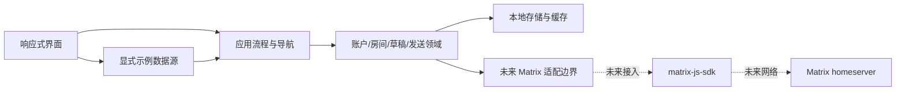
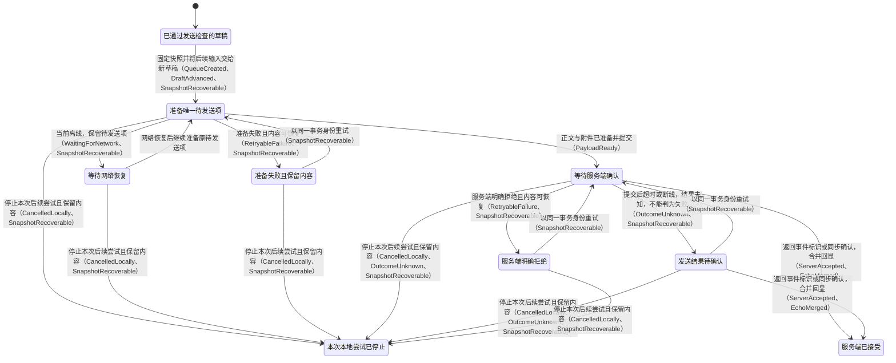

# Mirth 客户端核心规格

**状态:** Draft（目标行为与产品范围草案；未验证 Matrix 全功能兼容，不能据此启动完整产品实现）。
**版本:** 0.2（关键发送设计图已确认；其余能力补图、契约及数值为待审阅提案）。
**受众:** 用户核对可观察操作结果；产品与工程确定客户端范围；开发、测试及评审按 REQ、错误模型和验收标准实施与核验。
**范围:** 精干、响应式、多端 Matrix 客户端的目标行为；关键发送路径及首次认证、房间/空间、搜索、设备验证恢复、通话、设置与 PWA 结果。
**治理:** 行为变更先修改 §1.0 的操作路径，再归因 §9 并同步清单。结构、语义、实现与评审证据分别验证；未满足全部准入条件时保持 Draft，不能以 Demo 或空屏障冒充产品通过。
**变更历史:** 原架构讨论稿冻结于 `history/2026-11-16-旧架构讨论稿.md`；问题调查见 `issues/`，现行目标只以本文件为准。

## 1. 背景与目标

### 1.0 设计图景

以下是正式 Matrix 客户端应有的行为，不是示例数据 Demo 的运行结果。用户数据指消息、草稿、附件及回复上下文；界面布局变化不改变它们所属的账户与会话。

本图从用户已有一个已配置账户开始。首次发现服务器、注册、密码/SSO/OAuth 登录另有入口，不能把其中任何一种写死成本图的默认认证方式。

```text
用户打开 Mirth，应用读取所选账户的本地会话
|-- 本地会话可读取
|   +-- 会话服务检查凭据，并以所选账户启动同步
|       |-- 同步可继续
|       |   +-- 会话列表显示已知房间和同步状态，用户选择一个会话 -> 打开会话
|       |-- 网络不可达，但有本地会话数据
|       |   +-- 会话列表显示缓存及“离线”；用户仍可选择已缓存房间 -> 打开会话
|       |-- 网络不可达，也没有本地会话数据
|       |   +-- 界面显示“尚无缓存，无法加载会话”和重试入口
|       |       |-- 用户重试 -> 重新检查凭据并启动同步
|       |       +-- 用户不重试 -> 停留错误页，不显示伪造房间；本次加载终止
|       +-- 凭据失效且刷新不能恢复
|           +-- 界面要求重新认证，保留该账户待恢复的数据，不在其他账户下发送
|               |-- 用户完成认证 -> 以恢复后的账户重新启动同步
|               +-- 用户取消认证 -> 停留认证提示；本次在线同步终止
+-- 本地会话无法读取或不存在
    +-- 界面说明需要登录或本地会话不可读取；不宣称用户数据已删除
        +-- 用户进入对应认证/恢复入口；本图的已配置会话入口终止

用户选择会话，导航记录账户、房间和当前返回位置（打开会话）
+-- 房间服务提供当前可见的资料、成员身份与操作能力
    |-- 用户已加入，且可加载可见历史
    |   +-- 时间线显示消息窗口和历史缺口 -> 阅读消息
    |-- 用户已加入，历史加载失败，但有缓存
    |   +-- 时间线保留缓存，显示缺口与加载错误；编辑器按当前能力保留可用操作
    |       |-- 用户重试加载 -> 重新请求该房间的可见历史
    |       +-- 用户继续阅读缓存 -> 阅读消息，不把缓存标成完整历史
    |-- 用户已加入，历史加载失败且没有缓存
    |   +-- 时间线显示加载错误和重试入口；不显示“没有消息”
    |       |-- 用户重试 -> 重新请求该房间的可见历史
    |       +-- 用户返回列表 -> 恢复列表位置；本次阅读终止
    +-- 用户尚未加入、已离开或被禁止访问
        +-- 房间页显示实际成员状态及允许的加入/接受邀请/返回动作，禁止发送
            +-- 用户进入成员处理流程或返回列表；本次普通会话阅读入口终止

时间线向用户展示可见消息，并保留阅读位置（阅读消息）
|-- 消息内容可安全展示
|   +-- 消息组件展示有效内容、作者、时间、编辑/撤回/关系与信任信息
|       |-- 用户向前翻历史 -> 请求前一窗口；成功合并并保持锚点，失败保留窗口并显示重试
|       |-- 用户从搜索或链接定位消息 -> 请求目标上下文
|       |   |-- 可取得目标 -> 显示目标及上下文，记录原阅读位置
|       |   +-- 无法取得目标 -> 显示不可定位原因，保留原窗口；本次定位终止
|       |-- 用户直接输入 -> 编辑草稿
|       +-- 用户选择某条消息的“回复” -> 引用消息
|-- 加密消息仍在解密
|   +-- 消息位置显示“正在解密”，保留锚点
|       |-- 解密完成 -> 返回该消息的安全展示检查
|       +-- 解密失败 -> 显示无法解密的原因与可用恢复入口，不显示伪正文
|           |-- 用户完成适用的验证/密钥恢复 -> 对该消息重新请求解密
|           +-- 用户不恢复 -> 保留占位，继续阅读其他消息；该消息解密尝试终止
|-- 消息已撤回
|   +-- 消息组件显示撤回占位，不再展示其原正文；用户继续阅读
+-- 消息类型不支持、字段非法或信任策略禁止正文展示
    +-- 消息组件显示对应安全占位与允许的说明，不执行内容；用户继续阅读

用户阅读可见消息，读取状态服务决定是否更新读取位置
|-- 当前账户、房间和阅读作用域仍匹配，且消息在前台实际可见
|   +-- 读取状态服务按用户隐私设置更新本地位置及允许发送的回执
|       |-- 服务端接受 -> 更新相应读取状态，不把“已读”解释为对方阅读
|       +-- 离线或请求失败 -> 保留本地阅读位置，显示仍需同步；连接恢复后同步该位置
+-- 页面在后台、消息未实际可见或已切换上下文
    +-- 不因预加载或旧窗口更新而标记该消息已读；本次回执更新终止

用户在当前会话选择一条消息的“回复”（引用消息）
+-- 编辑器把目标消息标识与可安全展示的摘要关联到当前会话草稿
    |-- 用户取消回复 -> 仅移除引用，保留正文与附件 -> 编辑草稿
    |-- 目标随后撤回或正文不可再展示 -> 摘要改为相应占位，保留目标标识 -> 编辑草稿
    +-- 用户继续输入或选择附件 -> 编辑草稿

用户在当前会话输入正文或选择附件（编辑草稿）
|-- 正文输入或附件准备成功
|   +-- 草稿服务保存该账户、房间及回复/线程作用域的内容
|       |-- 用户切换会话或改变布局 -> 原草稿留在原作用域，新会话恢复自身草稿
|       |   +-- 用户回到原会话 -> 恢复正文、附件和引用；继续编辑草稿
|       |-- 用户点击发送，或在非输入法组合态按发送快捷键 -> 提交发送
|       +-- 用户继续编辑 -> 更新同一草稿，不创建消息
|-- 附件读取、类型或大小检查失败
|   +-- 附件区域显示具体失败，保留其余正文与已准备附件
|       |-- 用户移除失败项或重新选择 -> 编辑草稿
|       +-- 用户不处理 -> 失败项不进入发送；本次附件准备终止
+-- 草稿持久化失败
    +-- 编辑器保留内存中的内容并显示“尚未保存，关闭会丢失”
        |-- 用户重试保存 -> 重新保存同一草稿
        +-- 用户离开应用 -> 明确提醒未保存数据，由用户决定保留页面或确认离开

用户对当前草稿发出发送意图（提交发送）
+-- 发送服务重新核对账户、房间、当前发送权限与草稿内容
    |-- 没有正文和可发送附件
    |   +-- 不创建消息、不清空引用或草稿；焦点保留编辑器 -> 编辑草稿
    |-- 身份、成员关系或权限不允许发送
    |   +-- 显示原因，原草稿完整保留；本次提交终止
    +-- 可以发送
        +-- 发送服务固定本次内容快照与事务身份，创建唯一的本地待发送项
            +-- 草稿服务把该快照交给待发送项，新输入进入下一份草稿 -> 准备发送

发送服务处理唯一的待发送项（准备发送）
|-- 当前离线
|   +-- 时间线显示“等待网络”，不是“已发送”
|       |-- 连接恢复 -> 按同一事务身份继续准备发送
|       +-- 用户取消 -> 停止该待发送项；内容仍可查看、复制或恢复到编辑器
|-- 附件准备上传或加密失败
|   +-- 待发送项显示失败原因，保留正文、引用与附件，不自动丢弃内容
|       |-- 用户重试 -> 按同一待发送项重新准备，不重建可见消息
|       +-- 用户取消 -> 停止该待发送项；内容仍可查看、复制或恢复到编辑器
+-- 附件与正文已按房间要求准备完成
    +-- 发送服务通过 Matrix SDK 向该房间提交事件 -> 等待确认

发送服务等待服务端与同步结果（等待确认）
|-- 服务端明确拒绝
|   +-- 同一待发送项显示原因，保留可恢复内容，不标记为送达
|       |-- 用户在原因解除后重试 -> 按同一事务身份重新提交，不创建第二条可见消息
|       +-- 用户取消 -> 停止该待发送项；本次发送终止，内容仍可恢复
|-- 超时或断线，服务端是否接受尚不确定
|   +-- 同一待发送项显示“发送结果待确认”，不是确定失败或确定成功
|       |-- 同步收到对应事件 -> 合并为同一条消息，显示服务端已接受；本次发送确认终止
|       |-- 恢复连接后仍需重试 -> 按同一事务身份重新提交，继续等待确认
|       +-- 用户取消继续尝试 -> 停止后续请求并说明已到服务端的事件不能由本地取消撤回
+-- 服务端返回事件标识，或同步先收到对应事件
    +-- 发送服务按事务与事件标识合并本地/远端回显，不重复展示
        +-- 时间线显示服务端已接受；不冒充其他设备送达或对方已读；本次发送确认终止

用户把已取消或失败待发送项恢复到编辑器
|-- 当前作用域草稿为空
|   +-- 恢复该项的正文、引用与可恢复附件，原待发送项停止重试 -> 编辑草稿
+-- 当前作用域已有新草稿
    +-- 不覆盖新输入，显示“保留现有草稿；可复制失败内容”
        +-- 用户复制内容或继续编辑现有草稿；本次自动恢复终止
```

```text
首次认证（未配置账户的入口）
用户在欢迎页选择登录或注册
+-- 用户输入 homeserver 地址并继续
    |-- 服务端可达且版本/能力可读取 -> 展示认证方式与服务器身份，用户选择一种方式
    +-- 服务端不可达或响应不可用 -> 显示连接错误与重试；取消则回到欢迎页，本次发现终止
用户选择服务器提供的认证方式并提交认证
|-- 认证完成且账户身份可确认
|   +-- 安全存储服务保存账户凭据与服务器信息 -> 建立会话并启动同步
|       |-- 同步启动 -> 展示会话列表和同步状态，首次认证终止
|       +-- 同步暂不可用 -> 保留已认证账户，展示离线/重试入口；本次同步等待终止
+-- 认证被拒绝、用户取消或凭据保存失败
    +-- 不建立已登录会话；说明对应原因，保留可重新提交入口
        |-- 用户重试 -> 重新执行认证
        +-- 用户返回 -> 结束认证流程

用户从房间链接、邀请或目录选择目标房间（加入房间）
|-- 目标可见且用户已加入 -> 打开房间并加载可见消息
|-- 用户收到有效邀请
|   +-- 展示邀请来源、房间身份及加入/拒绝操作
|       |-- 用户接受 -> 房间服务请求加入
|       |   |-- 服务端确认加入 -> 更新成员状态，打开房间
|       |   +-- 拒绝或请求失败 -> 保留邀请与未加入状态，显示原因；用户重试或返回
|       |-- 用户拒绝 -> 房间服务提交拒绝
|       |   |-- 服务端确认拒绝 -> 从待处理邀请移除，保持未加入；本次邀请处理终止
|       |   +-- 请求失败 -> 保留邀请并显示错误；用户重试或返回
|       +-- 用户取消面板 -> 保留邀请，不提交加入或拒绝；本次处理终止
|-- 用户未加入且房间允许加入
|   +-- 展示加入确认，用户确认请求加入
|       |-- 服务端确认 -> 更新成员状态并加载房间
|       +-- 服务端拒绝、网络失败 -> 显示错误，保持未加入状态；可重试或返回
+-- 房间不存在、不可见或用户被禁止
    +-- 显示服务端可确认的原因；不泄漏不可见房间信息，不创建成员关系
        +-- 用户返回发现页或关闭链接；本次加入终止

用户在空间页展开或选择一个空间
|-- 空间层级可读（包括服务端允许的非成员浏览） -> 显示用户有权查看的子项；选择房间后按该房间成员状态打开或加入
+-- 服务端拒绝访问或请求失败 -> 不展示未获授权的新内容，区分访问被拒与加载失败；用户重试或返回空间列表

用户在当前账户的搜索页输入查询并选择范围（搜索）
|-- 用户取消查询 -> 停止当前查询并回到原视图；迟到结果不替换当前上下文
|-- 范围不具备正文搜索能力（包括没有可用本地索引的加密正文）
|   +-- 明示未覆盖范围，不把未搜索解释为无结果；用户切换范围或返回
|-- 查询为空 -> 显示搜索提示，不请求服务端
+-- 查询非空 -> 搜索服务按选定房间/范围请求匹配结果
    |-- 返回结果 -> 展示结果摘要、房间和时间；用户选择一项
    |   |-- 目标事件及上下文可访问 -> 打开房间、定位消息并保留返回位置
    |   +-- 目标事件不可再访问/无法定位 -> 显示无法定位原因，保留结果和原页面
    |-- 没有匹配项 -> 显示“无结果”，允许修改查询
    +-- 网络/服务端错误 -> 保留查询与已有结果，显示错误及重试

用户打开账户的设备验证面板（设备验证）
|-- 有待处理的设备验证请求 -> 显示设备身份、请求来源及验证选项
|   +-- 用户选择适用方式并完成双方确认
|       |-- 密码学验证和本地信任更新成功 -> 标记相应设备/用户身份已验证
|       +-- 比对失败、请求过期或任一方取消 -> 保持未验证，说明原因并允许重新发起
|-- 没有待处理请求 -> 提供从目标设备发起验证的步骤
+-- 验证所需设备/密钥不可用 -> 提供恢复入口，不把未验证设备标为可信

用户从设备面板选择密钥恢复（恢复）
|-- 用户拥有可用恢复凭据 -> 请求恢复密钥并验证恢复结果
|   |-- 恢复成功且密钥可用于目标设备 -> 保存到受保护存储，重试受影响消息解密
|   +-- 凭据错误、恢复材料缺失或服务端拒绝 -> 显示可区分错误；不覆盖现有密钥
+-- 用户没有恢复凭据
    +-- 说明缺少可用密钥的历史不能解密及重置的影响
        |-- 用户明确确认重置 -> 创建新的密钥状态并说明旧密钥保护内容不会因此解密
        +-- 用户取消 -> 不改变密钥状态并返回设备面板

用户从房间工具栏发起或接听通话（通话）
|-- 房间、对端与当前平台支持选定的通话模式 -> 请求麦克风/摄像头权限并建立通话会话
|   |-- 权限获准且呼叫建立 -> 显示通话状态和控制；用户挂断 -> 释放本地媒体并结束
|   |-- 用户在呼叫建立前取消 -> 停止呼叫并释放已取得资源；返回房间
|   +-- 权限拒绝、对端拒绝或连接失败 -> 显示失败原因，释放已取得资源；用户可返回房间
+-- 当前房间/平台没有可用通话能力 -> 显示不可用状态，不启动媒体采集

通话服务收到针对当前账户的来电
|-- 来电有效且尚未结束 -> 提示来电来源，不采集媒体
|   |-- 用户接听 -> 进入上方通话权限与建立流程
|   |-- 用户在私聊拒绝 -> 提交拒绝；成功移除来电，失败显示错误且不假称对端已收到
|   |-- 用户忽略群聊来电 -> 仅关闭本机提示，不终止其他人的通话；本次提示终止
|   +-- 用户不操作 -> 保留有效提示；到期、对端撤销或其他设备已处理时移除
+-- 来电过期、已撤销或已在其他设备处理 -> 不显示可接听状态，不启动媒体；本次来电处理终止

用户在设置页查看或修改账户、外观、通知、隐私、键盘与存储选项（设置）
|-- 修改值通过本地约束检查 -> 设置服务保存到对应账户或设备范围并应用
|   |-- 保存成功 -> 展示生效值
|   +-- 保存失败 -> 恢复上次确认值，提示未保存并提供重试
+-- 值不支持或用户取消编辑 -> 不写入，恢复上次确认值

用户在受支持浏览器安装或使用 PWA（PWA）
|-- 浏览器满足安装条件 -> 提供安装入口；用户确认安装 -> 浏览器完成安装并展示启动入口
|   +-- 用户取消或浏览器拒绝 -> 保持网页可用，说明未安装
|-- 用户启动已安装应用 -> 读取本地账户会话并按账户同步
|   |-- 在线 -> 展示正常在线会话
|   +-- 离线且有缓存 -> 展示缓存与离线状态，限制网络操作并保留本地草稿
|-- 缓存/存储不可读或被清除 -> 说明需重新认证及本地数据可用性，不宣称服务端数据已删除
|-- 浏览器没有安装入口 -> 网页保持可用，不伪造安装按钮或强迫换浏览器
+-- 用户开启后台通知 -> 平台服务检查权限、订阅与 Matrix 推送网关
    |-- 用户授权且订阅/网关注册均完成 -> 显示此设备已开启推送；不保证系统无限后台运行
    |-- 用户拒绝权限 -> 保持未开启，说明可从系统设置调整；本次申请终止
    +-- 浏览器不具备能力或订阅/网关失败 -> 说明具体环节，保留应用内未读；本次开启终止

用户在编辑器选择富文本格式、Markdown、提及、命令或粘贴内容
|-- 编辑器可表达且内容通过安全检查 -> 保留文档结构、撤销历史及当前会话草稿；用户提交时进入提交发送
|-- 粘贴包含不可执行或不允许的格式 -> 移除危险内容并说明格式变化，不执行脚本；用户继续编辑
+-- 中文输入法仍在组合或补全尚未确认 -> 输入仅更新草稿，不触发发送；确认后继续编辑

用户打开表情、贴纸或图片包面板
|-- 包可读取且用户选中条目 -> 编辑器插入适用内容或进入附件发送确认，按既有发送路径提交
|-- 用户添加、移除或调整包 -> 图片包服务保存账户/房间配置
|   |-- 服务端确认 -> 面板显示确认后的配置
|   +-- 请求失败 -> 保留上次确认配置和当前选择，显示重试入口
+-- 包不可读或用户关闭面板 -> 不插入内容，保持编辑器草稿；本次选择终止

用户对可操作消息选择编辑、反应、撤回、置顶或打开线程
|-- 编辑 -> 在独立编辑草稿中恢复可编辑内容，取消不改原消息；提交按编辑权限重新检查
|-- 反应、撤回或置顶 -> 关系服务重新检查当前权限并提交相应事件
|   |-- 服务端确认 -> 更新有效内容或聚合，不创建重复可见项
|   +-- 拒绝或请求失败 -> 恢复最后确认表现，保留错误及重试；不伪造撤回或置顶成功
+-- 打开线程 -> 关系服务读取线程根与可见窗口，显示独立回复作用域
    |-- 可读取 -> 线程回复进入其独立草稿与回执作用域，返回时恢复主时间线锚点
    +-- 无法读取 -> 保留主时间线，显示不可访问或加载失败；本次打开终止

用户打开媒体、共享文件或消息附件
|-- 媒体服务鉴权、下载、校验及所需解密成功 -> 查看器显示内容或提供保存入口
|   +-- 用户关闭查看器 -> 释放不再使用的媒体资源租约，返回原消息位置
+-- 鉴权、网络、校验、解密或格式失败 -> 显示具体阶段错误，不泄露凭据；用户重试或关闭

用户在详情页修改房间/空间资料、成员权限、加入规则、历史可见性、地址或层级
|-- 当前有权限且输入有效 -> 管理服务提交变更
|   |-- 服务端确认 -> 更新资料/权限视图，影响到的动作重新判断
|   +-- 权限变化、拒绝或请求失败 -> 保留未保存表单与最后确认状态，说明原因；用户重试或取消
+-- 用户无权限、输入无效或取消编辑 -> 不提交变更；取消仅放弃本次表单，回到详情页

用户明确选择房间升级、退出房间/空间或账户退出
|-- 用户取消影响确认 -> 不改变成员、账户或本地数据；本次操作终止
+-- 用户确认 -> 对应服务提交所选操作，不把离开空间扩展成离开所有子房间
    |-- 服务端确认 -> 显示新房间入口、已离开或已退出状态；本地数据清理按确认范围执行
    +-- 拒绝或请求失败 -> 保留最后确认状态与可恢复数据，说明未完成；用户重试或返回

用户查看通知收件箱、修改通知规则或屏蔽用户
|-- 收件箱请求成功 -> 显示事件与房间上下文；打开消息进入定位路径
|-- 用户设置全部/提及/静音、关键词、声音、邮件通知或屏蔽 -> 通知/账户服务保存对应规则
|   |-- 服务端或本地保存确认 -> 显示已生效值，通知与聚合按规则重新计算
|   +-- 保存失败 -> 保留最后确认值，说明未保存；用户重试或返回
+-- 收件箱请求失败 -> 保留已有结果和筛选，显示重试；不显示成无通知

用户查看设备、修改设备名或移除设备
|-- 设备列表可读取 -> 显示当前设备和其他设备；不把名称当作验证证据
|-- 用户确认修改或移除 -> 设备服务在当前认证模式允许的路径提交
|   |-- 确认完成 -> 更新设备状态；当前设备失去授权时进入重新认证路径
|   +-- 请求失败或外部账户管理尚未返回确认 -> 显示未完成，不伪造已移除；用户重试或返回
+-- 用户取消 -> 保持设备状态；本次操作终止

用户选择密钥导出、导入或备份设置
|-- 用户取消、口令错误或材料校验失败 -> 不覆盖密钥，保留具体错误；本次操作终止
+-- 材料和授权有效 -> 安全服务执行所选导出、导入或备份变更
    |-- 完成 -> 说明实际导出/恢复/备份范围；不把密钥文件称为全部消息正文备份
    +-- 存储、网络或版本冲突失败 -> 保留已有可用密钥，说明未完成范围；用户重试或返回

用户在开发工具查看事件或账户数据
|-- 读取成功 -> 以不可执行文本显示结构，隐藏凭据和秘密；只查看不修改
|-- 用户明确提交账户数据修改 -> 工具服务校验类型及权限后提交
|   |-- 服务端确认 -> 显示确认后的值
|   +-- 拒绝、冲突或请求失败 -> 保留最后确认值和未保存编辑，显示原因；用户重试或取消
+-- 读取失败或用户关闭 -> 显示错误或返回原页面，不新增数据变更

用户在会话内打开详情、搜索或设置，再按返回/Escape或改变窗口宽度
|-- 打开次级页面 -> 导航记录原会话和阅读位置，组件显示该账户/房间的数据
|-- 返回或关闭 -> 关闭相应临时层，恢复可见原页面与可达焦点，不留下阻断背景的模态层
+-- 窄屏与宽屏切换 -> 调整展示列和模态方式，保留草稿、空间筛选和当前任务；窄屏仍可切换空间
```

### 1.1 为什么写

当前目标是定义轻量、多端、响应式 Matrix 客户端能让用户完成哪些操作，以及失败、取消后仍可观察到什么。本文件描述目标而非现状；Demo 使用显式示例数据，不访问 homeserver 的演示形态。

### 1.2 目标

- GOAL-1：保持 §1.0 已批准的发送语义，并为首次使用、房间参与、发现与安全维护、通话、设置和 PWA 提供可实现的操作路径；按 §8 验收。
- GOAL-2：界面在窄屏与宽屏保持相同账户/房间/草稿语义，响应布局不改变数据归属；按“设置与多端响应界面”需求验收。
- GOAL-3：以 Demo 明确展示有限的本地示例流程，不暗示真实 homeserver、加密、通话或跨设备能力已实现。

### 1.3 非目标（Out of Scope）

- 产品功能下限为 Cinny v4.12.8，不能以轻量为由删除富文本、空间管理、图片包、通话、安全恢复或开发工具；逐项证据见调查报告，尚未闭合的核验登记在 issues。
- 本次交付是产品规格 Draft 与已确认范围的 UI Demo，不是完整 Matrix 产品；不宣称 Matrix 全部扩展或 Cinny 所有路径已实际验证。
- Demo 不连接 Matrix 服务端、注册账户、加解密真实消息、建立通话或实现 PWA 推送，不生成这些能力的假成功状态。
- 正式协议交互复用 matrix-js-sdk；不自行实现密码算法、完整同步引擎或另造通用 UI 框架。
- 服务端运维、应用商店分发不是 Web 客户端行为契约；客户端功能边界不能用这些非目标缩减。

## 2. 术语表

| 术语 | 定义 | 禁止同义词 |
|---|---|---|
| 账户作用域 | 单一 Matrix 身份及其 homeserver 下的数据归属边界 | 用户级全局状态 |
| 房间 | Matrix conversation 的客户端可见会话对象 | 群组（不得混同空间） |
| 空间 | 用于组织房间的 Matrix 结构；其成员关系与房间成员关系分开呈现 | 房间 |
| 待发送项 | 已从草稿原子接管、具有稳定事务身份且可重试/取消的一次发送快照 | 消息已发送 |
| 服务端接受 | 服务端确认事件被接收；不代表其他设备送达或对方已读 | 已送达、已读 |
| 本地缓存 | 客户端已保存的数据；未同步的变化和历史缺口必须显式呈现 | 完整历史 |
| Demo | 使用固定示例数据驱动的交互样例，不访问 homeserver 的演示形态 | 产品实现 |
| PWA | 浏览器可安装的渐进式 Web 应用形态；安装能力受浏览器控制 | 原生应用 |
| 设备验证 | 用户确认设备身份并更新信任状态的交互流程 | 登录认证 |
| 恢复 | 用户尝试取得既有加密密钥材料或明确重置密钥状态的流程 | 保证解密历史 |

## 3. 系统模型与状态机

### 3.1 架构与边界



依赖方向：界面消费应用流程提供的视图状态并发出用户意图；领域服务裁决账户、房间、草稿和发送语义；持久化服务保存账户隔离的数据；未来网络适配器封装 matrix-js-sdk。SDK、homeserver 与用户界面之间不得互相持有呈现细节。Demo 数据源仅提供明示的静态样例和确定性交互结果，不作为网络适配器的替身或兼容性证明。

组件责任：

| 组件 | 责任 | 不负责 |
|---|---|---|
| 界面与导航 | 呈现当前视图、输入用户意图、保存返回位置；响应宽度变化 | 裁决协议、持有跨账户共享草稿 |
| 应用协调器 | 选择账户/房间流程，串接成功、失败、取消结果 | 自行推断服务端成功 |
| 账户服务 | 首次认证入口、账户选择、会话恢复状态 | 把 Demo 认证当真实身份认证 |
| 房间与搜索服务 | 列表、加入状态、范围查询、定位上下文 | 暴露无权访问的房间内容 |
| 草稿与发送服务 | 草稿作用域、发送快照、事务身份、待发送状态与恢复 | 声称未知结果必然失败或成功 |
| 安全与设备服务 | 验证/恢复状态与安全提示 | 伪造密钥恢复成功 |
| 设置与 PWA 服务 | 设置作用域、安装/启动状态和可用性提示 | 绕过浏览器安装与权限结果 |
| Matrix 适配器（未来） | 通过 SDK 连接协议 API、归一化可观察响应 | UI 布局、Demo 样例、离线猜测协议结果 |
| 读取状态服务 | 按账户、房间与线程拥有已读位置及回执意图；结果交给列表和时间线 | 不因预加载标记已读，不把公开回执与私有回执混同 |
| 媒体服务 | 拥有上传/下载任务及对象资源租约；进度/错误交给附件区或查看器，最后消费者释放后回收 | 不让消息展示组件持有密钥或无界缓存 |
| 通话服务 | 拥有来电、通话、设备权限与媒体轨道；结果交给来电提示和通话面板；终止时释放 | 不因切换房间或隐藏面板而误挂断，不把忽略群聊来电当结束群呼 |
| 存储服务 | 拥有会话凭据、密钥库、草稿与缓存各自的持久化接口；错误返回对应账户/安全/草稿服务 | 不把可回收缓存与不可重建密钥使用同一清理策略 |
| 通知与平台服务 | 拥有通知规则、设备订阅和网关注册状态；结果交给收件箱、设置与平台提示 | 不将权限批准等同推送注册成功；不强制系统后台常驻 |

界面组件只消费所属服务的只读视图并提交意图。下面按 §1.0 中的用户动作分配责任；它们是组合边界，不是必须引入 Custom Elements、状态框架或同名目录的要求（D01、D03、D04）。

| 组件 | 输入与用户意图 | 状态/结果归属与失败后继 |
|---|---|---|
| 应用壳与导航 | 当前账户、会话、返回位置、可用布局；选择/返回/开关面板 | 导航持有路由与局部层状态；返回恢复可见焦点，布局变化不重建会话 |
| 会话与空间列表 | 房间摘要、空间可见子项、未读、筛选；选择/搜索/切空间 | 房间服务拥有确认数据，列表拥有临时筛选；加载失败保留已知内容，窄屏仍可改变筛选 |
| 时间线 | 事件窗口、缺口、锚点和解密状态；分页/定位/阅读 | 事件服务拥有协议窗口，视图拥有像素锚点；失败保留原窗口并提供重试 |
| 消息内容与动作 | 安全有效内容、信任信息、关系与操作权限；回复/编辑/反应/撤回/置顶 | 关系服务拥有聚合结果；拒绝时保留确认状态，不把不可信内容执行为 HTML |
| 线程面板 | 根事件、线程窗口、独立读状态；打开/回复/返回 | 线程作用域隔离草稿和回执；加载失败不破坏主时间线，返回恢复原位置 |
| 编辑器与补全 | 当前作用域文档、引用、附件、权限；编辑/补全/提交/取消 | 草稿服务拥有内容，编辑器拥有选区与撤销历史；失败不丢内容、输入法组合不发送 |
| 附件队列 | 文件元数据、准备/上传状态、大小约束；添加/取消/重试 | 媒体服务拥有任务；错误按文件显示，取消不能被视为上传完成 |
| 媒体查看器 | 受控资源及解密/格式状态；查看/保存/关闭 | 媒体服务拥有租约；失败说明阶段，关闭释放本组件不再使用的资源并恢复锚点 |
| 资料与管理面板 | 房间/用户资料、成员、规则和当前操作能力；修改/确认/取消 | 房间/账户服务拥有确认值，表单持有未保存编辑；权限变化导致拒绝时不伪成功 |
| 认证与账户入口 | 发现结果、服务端流程、账户恢复状态；选择/提交/取消 | 会话服务拥有事务和秘密；取消不建立会话，保存失败不假称登录完成 |
| 设备与安全流程 | 设备/信任、验证请求、备份恢复进度；验证/恢复/重置/导入导出 | 安全服务拥有密钥及事务；失败不覆盖既有可用密钥，不把账户登录等同可信 |
| 来电与活动通话面板 | 来电有效期、通话状态、权限/网络结果；接听/拒绝/忽略/挂断 | 通话服务拥有媒体资源；活动时保留，结束/取消/失败时回收 |
| 通知收件箱 | 通知、提及、邀请分类与读取位置；定位/接受/拒绝/已读 | 通知、房间、读取状态服务分别裁决；批量操作结果逐项呈现，不吞部分失败 |
| 图片包面板与设置 | 可用表情贴纸和包配置；选择/管理 | 图片包服务拥有确认配置；读取/保存失败保留草稿与原配置 |
| 设置与开发工具 | 设备/账户设置、可读事件/账户数据；保存/查看/显式修改 | 对应服务拥有确认值，工具输出不可执行且隐去秘密；失败保留原值和编辑 |
| 平台提示 | 安装、存储、权限、订阅/网关结果；安装/授权/重试 | 平台服务拥有设备状态；不支持时说明具体环节，不阻断普通网页使用 |

### 3.2 状态定义

发送语义只投影已通过提交检查后的一次本地尝试。`MS` 的布尔位表示该尝试仍活动，不表示正文或可恢复快照是否存在；终止后恢复内容、重复同步和远端事件展示由图中的相应流程负责，不由本模型伪造观测证明。无效输入、权限拒绝、读取回执及其他能力仍以操作图为准。

### 3.3 状态转换与旧代语义投影

以下旧代语义只投影 §1.0 已批准的发送子路径，用于固定驱动兼容式快照/渲染。它是 `legacy/unverified`，没有 strict Oracle 的观察入参和拒绝协议，不能据此宣称 strict pass；事件后继须与设计图人工逐项核对。状态标签与事件标签仅在 LABEL 围栏定义。

<!-- SEMANTICS:send BEGIN -->
```haskell
module Semantics where

data Phase = Editing | Preparing | WaitingNetwork | PreparationFailed
  | Awaiting | OutcomePending | Rejected | Accepted | Stopped
  deriving (Eq, Ord, Show, Read, Enum, Bounded)
data Ev = Submit | Offline | PrepareOk | PrepareFail | Retry | Cancel
  | Timeout | ServerReject | AcceptedEvent | ConnectionRestored
  deriving (Eq, Ord, Show, Read, Enum, Bounded)
data Effect = QueueCreated | DraftAdvanced | SnapshotRecoverable
  | WaitingForNetwork | PayloadReady | RetryableFailure | CancelledLocally
  | OutcomeUnknown | ServerAccepted | EchoMerged | Unreachable
  deriving (Eq, Ord, Show, Read)
data Detail = NoDetail deriving (Eq, Ord, Show, Read)
data MS = MS { msState :: Phase, hasQueue :: Bool } deriving (Eq, Ord, Show, Read)
data Edge = Edge { eFrom :: MS, eEvent :: Ev, eTo :: MS, eEffects :: [Effect] }
  deriving (Eq, Show)
data PropName = TerminalIsClosed | AcceptanceReachable | CancellationReachable
  deriving (Eq, Ord, Show, Read)

states :: [Phase]
states = [minBound .. maxBound]
terminalStates :: [Phase]
terminalStates = [Accepted, Stopped]
events :: [Ev]
events = [minBound .. maxBound]
initialState :: Phase
initialState = Editing

transition :: Phase -> Ev -> (Phase, [Effect])
transition Editing Submit = (Preparing, [QueueCreated, DraftAdvanced, SnapshotRecoverable])
transition Editing Offline = (Editing, [Unreachable])
transition Editing PrepareOk = (Editing, [Unreachable])
transition Editing PrepareFail = (Editing, [Unreachable])
transition Editing Retry = (Editing, [Unreachable])
transition Editing Cancel = (Editing, [Unreachable])
transition Editing Timeout = (Editing, [Unreachable])
transition Editing ServerReject = (Editing, [Unreachable])
transition Editing AcceptedEvent = (Editing, [Unreachable])
transition Editing ConnectionRestored = (Editing, [Unreachable])
transition Preparing Submit = (Preparing, [Unreachable])
transition Preparing Offline = (WaitingNetwork, [WaitingForNetwork, SnapshotRecoverable])
transition Preparing PrepareOk = (Awaiting, [PayloadReady])
transition Preparing PrepareFail = (PreparationFailed, [RetryableFailure, SnapshotRecoverable])
transition Preparing Retry = (Preparing, [Unreachable])
transition Preparing Cancel = (Stopped, [CancelledLocally, SnapshotRecoverable])
transition Preparing Timeout = (Preparing, [Unreachable])
transition Preparing ServerReject = (Preparing, [Unreachable])
transition Preparing AcceptedEvent = (Preparing, [Unreachable])
transition Preparing ConnectionRestored = (Preparing, [Unreachable])
transition WaitingNetwork Submit = (WaitingNetwork, [Unreachable])
transition WaitingNetwork Offline = (WaitingNetwork, [Unreachable])
transition WaitingNetwork PrepareOk = (WaitingNetwork, [Unreachable])
transition WaitingNetwork PrepareFail = (WaitingNetwork, [Unreachable])
transition WaitingNetwork Retry = (WaitingNetwork, [Unreachable])
transition WaitingNetwork Cancel = (Stopped, [CancelledLocally, SnapshotRecoverable])
transition WaitingNetwork Timeout = (WaitingNetwork, [Unreachable])
transition WaitingNetwork ServerReject = (WaitingNetwork, [Unreachable])
transition WaitingNetwork AcceptedEvent = (WaitingNetwork, [Unreachable])
transition WaitingNetwork ConnectionRestored = (Preparing, [])
transition PreparationFailed Submit = (PreparationFailed, [Unreachable])
transition PreparationFailed Offline = (PreparationFailed, [Unreachable])
transition PreparationFailed PrepareOk = (PreparationFailed, [Unreachable])
transition PreparationFailed PrepareFail = (PreparationFailed, [Unreachable])
transition PreparationFailed Retry = (Preparing, [SnapshotRecoverable])
transition PreparationFailed Cancel = (Stopped, [CancelledLocally, SnapshotRecoverable])
transition PreparationFailed Timeout = (PreparationFailed, [Unreachable])
transition PreparationFailed ServerReject = (PreparationFailed, [Unreachable])
transition PreparationFailed AcceptedEvent = (PreparationFailed, [Unreachable])
transition PreparationFailed ConnectionRestored = (PreparationFailed, [Unreachable])
transition Awaiting Submit = (Awaiting, [Unreachable])
transition Awaiting Offline = (Awaiting, [Unreachable])
transition Awaiting PrepareOk = (Awaiting, [Unreachable])
transition Awaiting PrepareFail = (Awaiting, [Unreachable])
transition Awaiting Retry = (Awaiting, [Unreachable])
transition Awaiting Cancel = (Stopped, [CancelledLocally, OutcomeUnknown, SnapshotRecoverable])
transition Awaiting Timeout = (OutcomePending, [OutcomeUnknown, SnapshotRecoverable])
transition Awaiting ServerReject = (Rejected, [RetryableFailure, SnapshotRecoverable])
transition Awaiting AcceptedEvent = (Accepted, [ServerAccepted, EchoMerged])
transition Awaiting ConnectionRestored = (Awaiting, [Unreachable])
transition OutcomePending Submit = (OutcomePending, [Unreachable])
transition OutcomePending Offline = (OutcomePending, [Unreachable])
transition OutcomePending PrepareOk = (OutcomePending, [Unreachable])
transition OutcomePending PrepareFail = (OutcomePending, [Unreachable])
transition OutcomePending Retry = (Awaiting, [SnapshotRecoverable])
transition OutcomePending Cancel = (Stopped, [CancelledLocally, OutcomeUnknown, SnapshotRecoverable])
transition OutcomePending Timeout = (OutcomePending, [Unreachable])
transition OutcomePending ServerReject = (OutcomePending, [Unreachable])
transition OutcomePending AcceptedEvent = (Accepted, [ServerAccepted, EchoMerged])
transition OutcomePending ConnectionRestored = (OutcomePending, [Unreachable])
transition Rejected Submit = (Rejected, [Unreachable])
transition Rejected Offline = (Rejected, [Unreachable])
transition Rejected PrepareOk = (Rejected, [Unreachable])
transition Rejected PrepareFail = (Rejected, [Unreachable])
transition Rejected Retry = (Awaiting, [SnapshotRecoverable])
transition Rejected Cancel = (Stopped, [CancelledLocally, SnapshotRecoverable])
transition Rejected Timeout = (Rejected, [Unreachable])
transition Rejected ServerReject = (Rejected, [Unreachable])
transition Rejected AcceptedEvent = (Rejected, [Unreachable])
transition Rejected ConnectionRestored = (Rejected, [Unreachable])
transition Accepted Submit = (Accepted, [Unreachable])
transition Accepted Offline = (Accepted, [Unreachable])
transition Accepted PrepareOk = (Accepted, [Unreachable])
transition Accepted PrepareFail = (Accepted, [Unreachable])
transition Accepted Retry = (Accepted, [Unreachable])
transition Accepted Cancel = (Accepted, [Unreachable])
transition Accepted Timeout = (Accepted, [Unreachable])
transition Accepted ServerReject = (Accepted, [Unreachable])
transition Accepted AcceptedEvent = (Accepted, [Unreachable])
transition Accepted ConnectionRestored = (Accepted, [Unreachable])
transition Stopped Submit = (Stopped, [Unreachable])
transition Stopped Offline = (Stopped, [Unreachable])
transition Stopped PrepareOk = (Stopped, [Unreachable])
transition Stopped PrepareFail = (Stopped, [Unreachable])
transition Stopped Retry = (Stopped, [Unreachable])
transition Stopped Cancel = (Stopped, [Unreachable])
transition Stopped Timeout = (Stopped, [Unreachable])
transition Stopped ServerReject = (Stopped, [Unreachable])
transition Stopped AcceptedEvent = (Stopped, [Unreachable])
transition Stopped ConnectionRestored = (Stopped, [Unreachable])

stepWith :: (Phase -> Ev -> (Phase, [Effect])) -> MS -> Ev -> (MS, [Effect])
stepWith trans original event =
  let (next, effects) = trans (msState original) event
  in if effects == [Unreachable]
     then (original, effects)
     else (MS next (next `notElem` [Editing, Accepted, Stopped]), effects)

edges :: [Edge]
edges =
  [ Edge from event to effects
  | state <- states, event <- events
  , let from = MS state (state `notElem` [Editing, Accepted, Stopped])
        (to, effects) = stepWith transition from event
  ]

reachable :: [Phase]
reachable = explore [initialState] []
  where
    explore [] seen = seen
    explore (state:rest) seen
      | state `elem` seen = explore rest seen
      | otherwise = explore (rest ++
          [msState (eTo edge) | edge <- edges, msState (eFrom edge) == state,
           eEffects edge /= [Unreachable]]) (state:seen)

propertyResults :: [(PropName, Int)]
propertyResults =
  [ (TerminalIsClosed, length [edge | edge <- edges,
       msState (eFrom edge) `elem` terminalStates, eEffects edge /= [Unreachable]])
  , (AcceptanceReachable, if Accepted `elem` reachable then 0 else 1)
  , (CancellationReachable, if Stopped `elem` reachable then 0 else 1)
  ]
traceExempt :: Ev -> Phase -> Phase -> [Effect] -> [Effect] -> Bool
traceExempt _ _ _ _ _ = False
marks :: MS -> [Detail]
marks _ = []
```
<!-- SEMANTICS:send END -->

```LABEL:send
state Editing = 已通过发送检查的草稿
state Preparing = 准备唯一待发送项
state WaitingNetwork = 等待网络恢复
state PreparationFailed = 准备失败且保留内容
state Awaiting = 等待服务端确认
state OutcomePending = 发送结果待确认
state Rejected = 服务端明确拒绝
state Accepted = 服务端已接受
state Stopped = 本次本地尝试已停止
event Submit = 固定快照并将后续输入交给新草稿
event Offline = 当前离线，保留待发送项
event PrepareOk = 正文与附件已准备并提交
event PrepareFail = 准备失败且内容可恢复
event Retry = 以同一事务身份重试
event Cancel = 停止本次后续尝试且保留内容
event Timeout = 提交后超时或断线，结果未知，不能判为失败
event ServerReject = 服务端明确拒绝且内容可恢复
event AcceptedEvent = 返回事件标识或同步确认，合并回显
event ConnectionRestored = 网络恢复后继续准备原待发送项
detail NoDetail = 无附加构型标记
```

下列状态图由固定驱动从嵌入语义渲染生成（RENDERED::send），禁止手改；生成结果不替代逐事件语义评审，也不证明真实协议实现。
<!-- RENDERED:send BEGIN -->

<!-- RENDERED:send END -->

### 3.4 外部输入域矩阵

| 图上输入 | 成功观察与后继 | 失败/取消观察与后继 | 裁决者 |
|---|---|---|---|
| 首次认证提交 | 身份确认、凭据保存后建立账户并启动同步 | 拒绝/取消/保存失败时不建会话，显示原因并可重试或返回 | 认证服务与安全存储 |
| 加入/接受邀请 | 服务端确认成员关系后打开房间 | 拒绝/断网保持未加入；不可见资源不泄露 | 房间服务 |
| 搜索并定位 | 展示结果并定位可访问上下文 | 空结果/定位失败/请求失败分别显示；保留查询 | 搜索与历史服务 |
| 设备验证/恢复 | 双方验证确认后更新信任；恢复成功才重新尝试解密 | 取消/过期/材料错误不改可信状态或覆盖密钥 | 安全服务与设备 |
| 通话权限/呼叫 | 权限与会话均成功后显示活动通话 | 拒绝/失败释放已取得资源；不支持时不采集 | 浏览器/平台与通话服务 |
| 设置保存 | 持久化成功后显示生效值 | 无效/取消不写；保存失败还原上次确认值 | 设置服务 |
| PWA 安装/启动 | 浏览器接受安装则展示入口；启动后读取账户 | 用户取消/浏览器拒绝仍留网页；缓存损坏提示重新认证 | 浏览器与本地存储 |
| 发送 | §1.0 规定的唯一事务项最终显示服务端接受或待确认 | 拒绝/超时/断线/取消保持草稿或可恢复项，未知结果不重建第二条消息 | 发送服务；服务端/同步提供事实 |

## 4. 功能需求与接口契约

跨层公开契约以界面可观察结果和调用方责任定义；具体 SDK 签名待版本核验，不在本 Draft 中伪造。

- REQ-001 关键发送路径
  - **作为**已加入房间的用户，**我希望**发送内容并获知其真实确认状态，**以便**区分待处理、未知与服务端接受。
  - **优先级:** P0
  - **契约:** 发送服务只创建一次发送快照和事务身份；超时/断线不证明失败；同一事件以事务/事件身份合并。目标线上适配由 Matrix SDK 边界消费。
  - **接口示例（目标契约，非现有代码签名）:** 请求为 `{ roomId, snapshot, transactionId }`；结果为 `Accepted { eventId } | Rejected { reason, recoverableSnapshot } | OutcomeUnknown { transactionId }`。正常响应 `Accepted { eventId }` 表示服务端接受；明确错误 `Rejected { reason, recoverableSnapshot }` 保留可恢复内容；超时响应 `OutcomeUnknown { transactionId }` 保留同一事务身份，不据此生成第二项。
  - **验收标准:** Given 草稿与可发送权限有效，When 用户发送，Then 唯一待发送项接管快照；Given 请求超时，When 尚无对应同步事件，Then 显示待确认且草稿可恢复；Given 收到对应事件，Then 仅一条可见消息显示服务端已接受。
- REQ-002 首次账户与认证
  - **作为**新用户，**我希望**选择服务器并使用其支持的认证方式，**以便**以明确账户身份开始同步。
  - **优先级:** P0
  - **验收标准:** Given 可达 homeserver，When 认证完成且凭据存储成功，Then 建立账户并进入同步；Given 用户取消或认证/存储失败，Then 不显示已登录并提供返回或重试。
- REQ-003 房间和空间参与
  - **作为**用户，**我希望**查看邀请并加入可加入房间或通过空间组织访问房间，**以便**只在服务端确认成员关系后参与。
  - **优先级:** P0
  - **验收标准:** Given 有效邀请且服务端确认接受，When 用户接受，Then 成员状态更新并打开房间；Given 拒绝/断网，Then 保持未加入且不得启用发送。
- REQ-004 搜索与定位
  - **作为**用户，**我希望**按选择范围搜索消息并跳到上下文，**以便**找回可访问信息。
  - **优先级:** P1
  - **验收标准:** Given 非空查询，When 返回匹配项且上下文可见，Then 定位目标并保留返回位置；Given 无匹配或无法定位，Then 区分空结果与访问/请求失败并保留查询。
- REQ-005 设备验证与恢复
  - **作为**用户，**我希望**核验设备身份并尝试恢复密钥，**以便**理解设备信任及历史解密限制。
  - **优先级:** P0
  - **验收标准:** Given 双方验证完成，When 服务端/本地确认，Then 更新设备信任；Given 验证取消、恢复材料错误或重置未确认，Then 不把设备标为可信、不覆盖既有密钥。
- REQ-006 通话
  - **作为**用户，**我希望**在能力可用时发起/接听通话，**以便**在房间内进行实时交流。
  - **优先级:** P1
  - **验收标准:** Given 平台/房间能力可用且权限批准，When 呼叫建立，Then 显示活动通话；Given 权限拒绝或呼叫失败，Then 释放已取得媒体资源并显示原因。
- REQ-007 设置与多端响应界面
  - **作为**用户，**我希望**调整账户/设备设置并在窄屏、宽屏继续相同任务，**以便**设置生效且状态不随布局漂移。
  - **优先级:** P1
  - **验收标准:** Given 合法设置变更，When 保存成功，Then 显示生效值；Given 保存失败，Then 还原上次确认值；Given 视口从 360 CSS px 到 1440 CSS px 变化，Then 当前账户、房间、草稿及阅读位置不变且主要操作可用。
- REQ-008 PWA 安装与启动
  - **作为**支持浏览器的用户，**我希望**安装或在网页继续使用客户端，**以便**选择合适的启动方式。
  - **优先级:** P2
  - **验收标准:** Given 浏览器提供安装且用户接受，When 安装完成，Then 出现可启动入口；Given 用户取消/浏览器拒绝，Then 网页仍可用；离线启动只显示缓存且未同步状态。
- REQ-009 基线操作与组件责任
  - **作为**从 Cinny 迁移的用户，**我希望**保留富文本、图片包、消息动作、房间/空间管理、设备工具和收件箱，**以便**无需因轻量界面放弃已有操作。
  - **优先级:** P0
  - **契约:** 对应 §1.0 追加操作图与 §3.1 的组件输入、意图、所有者及失败后继；视图组件不自行伪造服务端确认。每一项基线操作在产品验收前均须有固定版本证据与成功/失败情景。
  - **验收标准:** Given 相应输入与权限有效，When 用户执行所选操作，Then 结果由表中指定服务确认后呈现；Given 取消、权限变化或请求失败，Then 按图保留原数据或未保存内容，不把失败显示成成功。

## 5. 错误模型

本表是目标分类，不声称已存在 SDK 错误码。SDK 原始错误、HTTP 状态与 Matrix errcode 的版本映射待核验，归 issue 跟踪。

| 类别 | 产生条件 | 用户观察及状态 | 恢复责任 |
|---|---|---|---|
| 未入队 | 认证/授权/权限校验失败，或空草稿 | 不显示待发送项；原草稿保留 | 用户修改/认证后重试 |
| 提交前断线 | 已建立快照，但事件请求尚未交给传输层时离线 | 显示等待网络；维持唯一待发送项 | 网络恢复后继续准备同一项 |
| 提交后结果未知 | 事件已交给传输层，但超时或断线后无明确拒绝或接受响应 | 显示发送结果待确认，不归类等待网络或确定失败 | 同步确认；必要重试使用同一事务身份 |
| 用户取消 | 用户停止本地后续尝试 | 显示本地已停止；提示不能撤回已到服务端事件 | 用户自行恢复内容或查看同步 |
| 重复回包/重复同步 | 同一事务或事件再次出现 | 合并到原可见项，不增生重复消息 | 发送/同步合并责任 |
| 过期代际/旧上下文 | 账户、房间或请求代际变化后旧回包到达 | 不覆盖当前账户/房间状态 | 应用协调器丢弃过期结果 |
| 资源耗尽 | 存储、队列、媒体设备或浏览器配额不足 | 保留已确认数据；拒绝新任务并说明限制 | 用户清理/释放资源；不得无界扩容 |
| 数据不可读 | 本地凭据/缓存损坏或权限撤销 | 明示需重新认证/缓存不可用；不宣称服务端数据删除 | 账户服务与用户重新认证 |
| 验证/恢复拒绝 | 对端拒绝、材料错误、请求过期 | 不改变信任，不覆盖密钥；显示可操作原因 | 用户重新发起或取消 |
| 服务能力不可用 | 房间/平台不支持通话、安装或搜索能力 | 显示不可用，不伪装成功 | 提供网页/房间返回等可用路径 |

没有自动重放语义的操作不得由通用网络层自动重试。重试只由掌握操作幂等身份的服务发起；本地取消不保证撤回服务端已接受事件。

## 6. 非功能需求（NFR）

以下为需经目标设备与服务端实测后确认的拟议验收阈值，不是现有产品数据。

| 指标 | 拟议阈值 | 测量边界 |
|---|---:|---|
| 冷启动至可交互 | 本地 Demo P95 ≤ 2.0 s；目标在线版本 P95 ≤ 3.0 s | 100 次启动，指定中端移动设备；在线含已保存账户 |
| 列表滚动帧耗时 | 60 Hz 设备上 P95 帧耗时 ≤ 18.2 ms | 500 条混合消息、连续 30 s；不是取高百分位 fps |
| 首屏消息展示 | 缓存命中 P95 ≤ 300 ms；在线首批结果 P95 ≤ 2.0 s | 100 次相同测试环境请求 |
| 客户端并发 | 1 个前台账户同步流；最多 4 个活动房间视图任务 | 超出时排队，不启无界任务 |
| 网络恢复 | 网络恢复后 ≤ 30 s 内恢复同步尝试；发送重试由明确策略最多 3 次，退避上限 30 s | 在线服务端可达且用户未取消 |
| 降级 | 无网络时缓存阅读和本地草稿可用；搜索/发送/加入/通话明确不可用或等待 | UI 不把待处理标成服务端成功 |
| 安全 | 凭据和密钥仅交由会话/加密存储所有者管理；普通界面状态、日志、URL不记录令牌或恢复密钥 | 同源脚本注入仍需防护，浏览器本地加密不构成 XSS 防御 |
| 数据保留 | 可重建消息/媒体缓存拟议保留 30 日；未发送草稿、待发送快照与加密密钥不适用缓存过期清理 | 用户主动删除这些数据前说明影响并确认，清本地不等于删除服务端数据 |
| 容量/背压 | 每房间本地消息缓存上限 10,000 项；待发送队列上限 100 项/账户；达到上限拒绝新入队并保留可恢复内容 | 不通过无界内存扩容掩盖过载 |

## 7. 异常与边界条件

| 场景 | 目标行为 | 可观察结果 | 测试锚点 |
|---|---|---|---|
| 账户 A 回包在切换到 B 后到达 | 不写入 B 的视图/缓存 | B 内容与草稿不变 | Draft：未接线 |
| 不可见房间被搜索定位 | 不暴露房间名/消息正文 | 通用不可访问提示，保留当前页面 | Draft：未接线 |
| 输入法组合期间发送快捷键 | 不提交，直到组合完成 | 编辑内容保持 | 已批准 §1.0 |
| 用户在发送待确认时取消 | 只停止本地后续尝试 | 显示未确认，说明后续同步仍能收到已被接受的事件 | 已批准 §1.0 |
| 验证双方设备不同步 | 不更新可信状态 | 显示未完成/失败 | Draft：未接线 |
| 摄像头权限已拒绝 | 不反复请求、不采集 | 可返回房间或调整系统权限 | Draft：未接线 |
| 浏览器拒绝 PWA 安装 | 继续网页交互 | 显示安装未完成 | Draft：未接线 |
| 设置本地写入失败 | 恢复上次确认值 | 明确未保存并给重试 | Draft：未接线 |
| 本地缓存读取损坏 | 隔离不可读缓存 | 提示重新认证/缓存不可用 | Draft：未接线 |

## 8. 验收标准

- AC-001 / 关键发送路径：逐路径核对图中未入队、入队后断线、超时未知、明确拒绝、取消、对应同步接受；同一事务不产生重复可见消息。
- AC-002 / 首次账户与认证：认证成功、取消、拒绝、凭据保存失败四种观察分别符合图，未成功时不进入已登录会话。
- AC-003 / 房间和空间参与：加入、接受邀请、拒绝、网络失败及不可见房间均不混淆成员状态与空间组织。
- AC-004 / 搜索与定位：空查询不发请求；无结果、请求失败、目标不可访问三类结果不同；定位成功可返回原位置。
- AC-005 / 设备验证与恢复：只有明确验证成功才更新信任；取消/错误恢复不覆盖已有密钥；重置必须二次明确确认。
- AC-006 / 通话：呼叫建立后保留活动媒体；挂断、取消、失败或通话结束后释放资源；有效来电可接听、私聊拒绝、群聊仅本机忽略，过期/撤销/其他设备处理后提示移除。
- AC-007 / 设置与多端响应界面：按 §6 设备和数据集测量 NFR；360/768/1440 CSS px 下账户/房间/草稿/阅读位置一致。
- AC-008 / PWA 安装与启动：安装成功、取消、拒绝、在线启动、离线缓存启动和缓存不可读按图呈现。
- AC-009：Demo 所有内容由本地示例数据驱动；网络面板/说明明确标注未连接 homeserver，不生成真实服务端成功状态。
- AC-010：固定驱动生成的状态图、快照与嵌入语义一致；性质与逐事件评审分别检查。缺少真实协议运行证据时不计 strict pass，实际结果记录在本规格 tools/README.md 与评审材料。
- AC-011 / 基线操作与组件责任：按 §1.0 的富文本、图片包、消息动作、媒体、管理、通知、设备、安全工具、开发工具与导航路径逐项核对 §3.1 所有者和结果接收方；缺少来源或运行证据的项不能从产品验收中删除。

## 9. 决策日志

| ID | 决策及来源 | 主要影响章节 | 验证规则 |
|---|---|---|---|
| D01 | 用户已批准原有发送关键路径：唯一事务、未知结果不冒充失败、取消不撤回 | §1.0、§3.3、§4、§5、§8 | 对照图每个可达事件与标签；旧代仅兼容，不计 strict pass |
| D02 | 用户确认无框架优先、matrix-js-sdk、交互原语路线，先选型说明和 Demo；演示不等于产品实现 | §1.2–1.3、§3.1、§4、§8 | Demo 不生成真实协议成功状态，SDK版本核验仍 open |
| D03 | 用户指定 Cinny v4.12.8 功能下限；作者提出认证、参与、安全、通话、管理、图片包、工具及 PWA 的补图与组件契约，尚待用户审阅 | §1.0、§3.1、§4–§8 | 每项操作对应图、组件所有者和失败后继，核验缺口见 issues，不宣称已完成基线对齐 |
| D04 | 用户要求多端与响应式；作者提出 §6 数值供后续评估，未获用户批准也未测量 | §3、§6、§8 | 视图变化不改变数据归属，拟议性能阈值不能当作实测 |

## 10. 验证

- 结构审计：`python tools/test_audit_spec.py && python tools/audit_spec.py`
- 验收屏障：`python tools/barriers.py`
- 旧代发送语义生成/编译与渲染：`python .claude/skills/core-spec/tools/spec_barrier.py docs/specs/client-core --update-snapshot`（仅更新 Draft 投影/快照；不会把旧代变成 strict Oracle）。
- 评审门：共享工具 `--emit` 生成材料，评审者逐事件核对图/SEMANTICS/LABEL 后由 `--record` 留档；`--check` 只核对留档新鲜度，不代替语义判断。
- 测试锚点清单：无已接线测试锚点；不得添加假锚点。Draft 可以未命中，切换 authoritative 前必须真实实现、增加测试并纳入屏障。
- 屏障清单：目前为空；Draft 状态不得将空屏障解释为通过。
