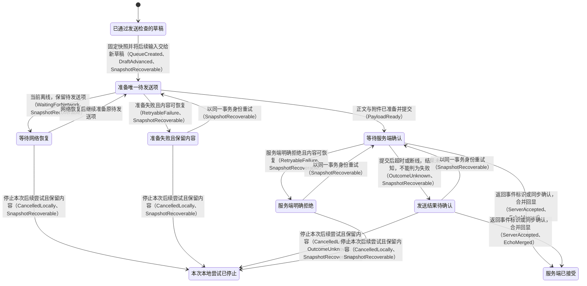

# 消息发送规格

**状态:** Draft；目标协议行为未实现，旧代语义不计 strict pass。
**版本:** 0.1（D01–D03）。
**受众:** 开发核对发送与同步职责；用户核对失败/取消结果；评审逐事件检查投影。
**范围:** 普通新消息（含回复、线程消息、附件）的有效草稿提交到服务端接受或本地停止，以及失败内容恢复。编辑/反应/撤回/置顶由会话交互域关系服务持有，不进入本域队列。
**治理:** 先修改 §1.0，再更新契约、决策、嵌入语义和验证；Draft 不等于产品验收。
**变更历史:** 由原聚合 client-core 的用户已确认发送路径拆出；用户要求按行为域拆分，历史材料见 history/。

## 1. 背景与目标

### 1.0 设计图景

入口由[会话交互](../conversation-ui/spec.md)提供当前账户、房间、草稿作用域与内容；权限由[房间与空间](../rooms-spaces/spec.md)提供，加密与身份边界见[账户与安全](../session-security/spec.md)。图中的取消只停止本地请求，不等于撤回服务端事件。

```text
用户对当前草稿发出发送意图（提交发送）
+-- 发送服务重新核对账户、房间、当前发送权限与草稿内容
    |-- 没有正文和可发送附件
    |   +-- 不创建消息、不清空引用或草稿；焦点保留编辑器 -> 编辑草稿
    |-- 身份、成员关系或权限不允许发送
    |   +-- 显示原因，原草稿完整保留；本次提交终止
    +-- 可以发送
        +-- 发送服务固定本次内容快照与事务身份，创建唯一的本地待发送项
            +-- 草稿服务把该快照交给待发送项，新输入进入下一份草稿 -> 准备发送

发送服务处理唯一的待发送项（准备发送）
|-- 当前离线
|   +-- 时间线显示“等待网络”，不是“已发送”
|       |-- 连接恢复 -> 按同一事务身份继续准备发送
|       +-- 用户取消 -> 停止该待发送项；内容仍可查看、复制或恢复到编辑器
|-- 附件准备上传或加密失败
|   +-- 待发送项显示失败原因，保留正文、引用与附件，不自动丢弃内容
|       |-- 用户重试 -> 按同一待发送项重新准备，不重建可见消息
|       +-- 用户取消 -> 停止该待发送项；内容仍可查看、复制或恢复到编辑器
+-- 附件与正文已按房间要求准备完成
    +-- 发送服务通过 Matrix SDK 向该房间提交事件 -> 等待确认

发送服务等待服务端与同步结果（等待确认）
|-- 服务端明确拒绝
|   +-- 同一待发送项显示原因，保留可恢复内容，不标记为送达
|       |-- 用户在原因解除后重试 -> 按同一事务身份重新提交，不创建第二条可见消息
|       +-- 用户取消 -> 停止该待发送项；本次发送终止，内容仍可恢复
|-- 超时或断线，服务端是否接受尚不确定
|   +-- 同一待发送项显示“发送结果待确认”，不是确定失败或确定成功
|       |-- 同步收到对应事件 -> 合并为同一条消息，显示服务端已接受；本次发送确认终止
|       |-- 恢复连接后仍需重试 -> 按同一事务身份重新提交，继续等待确认
|       +-- 用户取消继续尝试 -> 停止后续请求并说明已到服务端的事件不能由本地取消撤回
+-- 服务端返回事件标识，或同步先收到对应事件
    +-- 发送服务按事务与事件标识合并本地/远端回显，不重复展示
        +-- 时间线显示服务端已接受；不冒充其他设备送达或对方已读；本次发送确认终止

用户把已取消或失败待发送项恢复到编辑器
|-- 当前作用域草稿为空
|   +-- 恢复该项的正文、引用与可恢复附件，原待发送项停止重试 -> 编辑草稿
+-- 当前作用域已有新草稿
    +-- 不覆盖新输入，显示“保留现有草稿；可复制失败内容”
        +-- 用户复制内容或继续编辑现有草稿；本次自动恢复终止
```

### 1.1 目标与非目标

目标是让用户分清未提交、等待网络、结果未知与服务端接受，并保留可恢复内容。非目标是不重建 SDK 的全部内部状态、不承诺送达/已读、不以本地 Demo 的消息追加证明真实协议发送。

## 2. 术语表

| 术语 | 定义 |
|---|---|
| 草稿作用域 | 账户、房间及回复/线程上下文组成的数据归属，来自会话交互规格 |
| 待发送项 | 从有效草稿接管的不可变内容快照及稳定事务身份；后续输入属于新草稿 |
| 结果未知 | 事件已交给传输层，但没有明确拒绝或接受证据 |
| 服务端接受 | 返回事件标识或同步确认对应事件；不代表其他设备送达或对方已读 |
| 本地停止 | 停止本次后续请求，保留查看/复制/恢复内容；不阻止已被接受的远端事件随后同步到达 |

## 3. 系统模型与状态机

### 3.1 组件与结果归属

| 组件 | 输入与输出 | 状态所有者与失败后继 |
|---|---|---|
| 发送协调器 | 接收固定账户/房间/草稿；输出待发送视图和事务结果 | 拥有发送项与事务身份；预提交拒绝不清草稿，提交后未知不重建项 |
| 附件准备适配 | 接收该项的附件；输出准备/上传进度与可提交内容 | 媒体任务所有者报告结果并在取消/结束后释放无消费者资源；失败内容可恢复 |
| Matrix 适配 | 调用 SDK 提交并接收 HTTP/同步事实 | 不把通用网络错误猜成明确拒绝；不自己控制弹窗或编辑器 |
| 回显合并 | 消费事务身份、事件标识与 SDK 同步视图 | 将本地与远端关联为一条可见消息；重复同步不重复追加 |
| 恢复入口 | 用户选择恢复失败内容，向草稿服务提交作用域和快照 | 草稿服务决定空草稿可接收；已有新输入时不覆盖，只提供复制 |

同一操作的事务身份在重试中保持，队列、媒体任务与资源租约不混用身份。账户切换后旧异步结果只能进入其原账户结果，不覆盖当前视图。

### 3.2 内嵌语义的边界

只投影通过提交检查后的一次本地尝试。MS 布尔位表示本次尝试仍活动，不表示快照是否存在。终止后恢复内容、重复同步与远端事件展示由图上相应责任处理。下面是 legacy/unverified 兼容模型：没有真实事务/内容观察入参，不能机械证明事务身份、内容恢复或去重实际发生，也不是完整客户端状态机。

<!-- SEMANTICS:send BEGIN -->
```haskell
module Semantics where

data Phase = Editing | Preparing | WaitingNetwork | PreparationFailed
  | Awaiting | OutcomePending | Rejected | Accepted | Stopped
  deriving (Eq, Ord, Show, Read, Enum, Bounded)
data Ev = Submit | Offline | PrepareOk | PrepareFail | Retry | Cancel
  | Timeout | ServerReject | AcceptedEvent | ConnectionRestored
  deriving (Eq, Ord, Show, Read, Enum, Bounded)
data Effect = QueueCreated | DraftAdvanced | SnapshotRecoverable
  | WaitingForNetwork | PayloadReady | RetryableFailure | CancelledLocally
  | OutcomeUnknown | ServerAccepted | EchoMerged | Unreachable
  deriving (Eq, Ord, Show, Read)
data Detail = NoDetail deriving (Eq, Ord, Show, Read)
data MS = MS { msState :: Phase, hasQueue :: Bool } deriving (Eq, Ord, Show, Read)
data Edge = Edge { eFrom :: MS, eEvent :: Ev, eTo :: MS, eEffects :: [Effect] }
  deriving (Eq, Show)
data PropName = TerminalIsClosed | AcceptanceReachable | CancellationReachable
  deriving (Eq, Ord, Show, Read)

states :: [Phase]
states = [minBound .. maxBound]
terminalStates :: [Phase]
terminalStates = [Accepted, Stopped]
events :: [Ev]
events = [minBound .. maxBound]
initialState :: Phase
initialState = Editing

transition :: Phase -> Ev -> (Phase, [Effect])
transition Editing Submit = (Preparing, [QueueCreated, DraftAdvanced, SnapshotRecoverable])
transition Editing Offline = (Editing, [Unreachable])
transition Editing PrepareOk = (Editing, [Unreachable])
transition Editing PrepareFail = (Editing, [Unreachable])
transition Editing Retry = (Editing, [Unreachable])
transition Editing Cancel = (Editing, [Unreachable])
transition Editing Timeout = (Editing, [Unreachable])
transition Editing ServerReject = (Editing, [Unreachable])
transition Editing AcceptedEvent = (Editing, [Unreachable])
transition Editing ConnectionRestored = (Editing, [Unreachable])
transition Preparing Submit = (Preparing, [Unreachable])
transition Preparing Offline = (WaitingNetwork, [WaitingForNetwork, SnapshotRecoverable])
transition Preparing PrepareOk = (Awaiting, [PayloadReady])
transition Preparing PrepareFail = (PreparationFailed, [RetryableFailure, SnapshotRecoverable])
transition Preparing Retry = (Preparing, [Unreachable])
transition Preparing Cancel = (Preparing, [Unreachable])
transition Preparing Timeout = (Preparing, [Unreachable])
transition Preparing ServerReject = (Preparing, [Unreachable])
transition Preparing AcceptedEvent = (Preparing, [Unreachable])
transition Preparing ConnectionRestored = (Preparing, [Unreachable])
transition WaitingNetwork Submit = (WaitingNetwork, [Unreachable])
transition WaitingNetwork Offline = (WaitingNetwork, [Unreachable])
transition WaitingNetwork PrepareOk = (WaitingNetwork, [Unreachable])
transition WaitingNetwork PrepareFail = (WaitingNetwork, [Unreachable])
transition WaitingNetwork Retry = (WaitingNetwork, [Unreachable])
transition WaitingNetwork Cancel = (Stopped, [CancelledLocally, SnapshotRecoverable])
transition WaitingNetwork Timeout = (WaitingNetwork, [Unreachable])
transition WaitingNetwork ServerReject = (WaitingNetwork, [Unreachable])
transition WaitingNetwork AcceptedEvent = (WaitingNetwork, [Unreachable])
transition WaitingNetwork ConnectionRestored = (Preparing, [])
transition PreparationFailed Submit = (PreparationFailed, [Unreachable])
transition PreparationFailed Offline = (PreparationFailed, [Unreachable])
transition PreparationFailed PrepareOk = (PreparationFailed, [Unreachable])
transition PreparationFailed PrepareFail = (PreparationFailed, [Unreachable])
transition PreparationFailed Retry = (Preparing, [SnapshotRecoverable])
transition PreparationFailed Cancel = (Stopped, [CancelledLocally, SnapshotRecoverable])
transition PreparationFailed Timeout = (PreparationFailed, [Unreachable])
transition PreparationFailed ServerReject = (PreparationFailed, [Unreachable])
transition PreparationFailed AcceptedEvent = (PreparationFailed, [Unreachable])
transition PreparationFailed ConnectionRestored = (PreparationFailed, [Unreachable])
transition Awaiting Submit = (Awaiting, [Unreachable])
transition Awaiting Offline = (Awaiting, [Unreachable])
transition Awaiting PrepareOk = (Awaiting, [Unreachable])
transition Awaiting PrepareFail = (Awaiting, [Unreachable])
transition Awaiting Retry = (Awaiting, [Unreachable])
transition Awaiting Cancel = (Awaiting, [Unreachable])
transition Awaiting Timeout = (OutcomePending, [OutcomeUnknown, SnapshotRecoverable])
transition Awaiting ServerReject = (Rejected, [RetryableFailure, SnapshotRecoverable])
transition Awaiting AcceptedEvent = (Accepted, [ServerAccepted, EchoMerged])
transition Awaiting ConnectionRestored = (Awaiting, [Unreachable])
transition OutcomePending Submit = (OutcomePending, [Unreachable])
transition OutcomePending Offline = (OutcomePending, [Unreachable])
transition OutcomePending PrepareOk = (OutcomePending, [Unreachable])
transition OutcomePending PrepareFail = (OutcomePending, [Unreachable])
transition OutcomePending Retry = (Awaiting, [SnapshotRecoverable])
transition OutcomePending Cancel = (Stopped, [CancelledLocally, OutcomeUnknown, SnapshotRecoverable])
transition OutcomePending Timeout = (OutcomePending, [Unreachable])
transition OutcomePending ServerReject = (OutcomePending, [Unreachable])
transition OutcomePending AcceptedEvent = (Accepted, [ServerAccepted, EchoMerged])
transition OutcomePending ConnectionRestored = (OutcomePending, [Unreachable])
transition Rejected Submit = (Rejected, [Unreachable])
transition Rejected Offline = (Rejected, [Unreachable])
transition Rejected PrepareOk = (Rejected, [Unreachable])
transition Rejected PrepareFail = (Rejected, [Unreachable])
transition Rejected Retry = (Awaiting, [SnapshotRecoverable])
transition Rejected Cancel = (Stopped, [CancelledLocally, SnapshotRecoverable])
transition Rejected Timeout = (Rejected, [Unreachable])
transition Rejected ServerReject = (Rejected, [Unreachable])
transition Rejected AcceptedEvent = (Rejected, [Unreachable])
transition Rejected ConnectionRestored = (Rejected, [Unreachable])
transition Accepted Submit = (Accepted, [Unreachable])
transition Accepted Offline = (Accepted, [Unreachable])
transition Accepted PrepareOk = (Accepted, [Unreachable])
transition Accepted PrepareFail = (Accepted, [Unreachable])
transition Accepted Retry = (Accepted, [Unreachable])
transition Accepted Cancel = (Accepted, [Unreachable])
transition Accepted Timeout = (Accepted, [Unreachable])
transition Accepted ServerReject = (Accepted, [Unreachable])
transition Accepted AcceptedEvent = (Accepted, [Unreachable])
transition Accepted ConnectionRestored = (Accepted, [Unreachable])
transition Stopped Submit = (Stopped, [Unreachable])
transition Stopped Offline = (Stopped, [Unreachable])
transition Stopped PrepareOk = (Stopped, [Unreachable])
transition Stopped PrepareFail = (Stopped, [Unreachable])
transition Stopped Retry = (Stopped, [Unreachable])
transition Stopped Cancel = (Stopped, [Unreachable])
transition Stopped Timeout = (Stopped, [Unreachable])
transition Stopped ServerReject = (Stopped, [Unreachable])
transition Stopped AcceptedEvent = (Stopped, [Unreachable])
transition Stopped ConnectionRestored = (Stopped, [Unreachable])

stepWith :: (Phase -> Ev -> (Phase, [Effect])) -> MS -> Ev -> (MS, [Effect])
stepWith trans original event =
  let (next, effects) = trans (msState original) event
  in if effects == [Unreachable]
     then (original, effects)
     else (MS next (next `notElem` [Editing, Accepted, Stopped]), effects)

edges :: [Edge]
edges =
  [ Edge from event to effects
  | state <- states, event <- events
  , let from = MS state (state `notElem` [Editing, Accepted, Stopped])
        (to, effects) = stepWith transition from event
  ]

reachable :: [Phase]
reachable = explore [initialState] []
  where
    explore [] seen = seen
    explore (state:rest) seen
      | state `elem` seen = explore rest seen
      | otherwise = explore (rest ++
          [msState (eTo edge) | edge <- edges, msState (eFrom edge) == state,
           eEffects edge /= [Unreachable]]) (state:seen)

propertyResults :: [(PropName, Int)]
propertyResults =
  [ (TerminalIsClosed, length [edge | edge <- edges,
       msState (eFrom edge) `elem` terminalStates, eEffects edge /= [Unreachable]])
  , (AcceptanceReachable, if Accepted `elem` reachable then 0 else 1)
  , (CancellationReachable, if Stopped `elem` reachable then 0 else 1)
  ]
traceExempt :: Ev -> Phase -> Phase -> [Effect] -> [Effect] -> Bool
traceExempt _ _ _ _ _ = False
marks :: MS -> [Detail]
marks _ = []
```
<!-- SEMANTICS:send END -->

```LABEL:send
state Editing = 已通过发送检查的草稿
state Preparing = 准备唯一待发送项
state WaitingNetwork = 等待网络恢复
state PreparationFailed = 准备失败且保留内容
state Awaiting = 等待服务端确认
state OutcomePending = 发送结果待确认
state Rejected = 服务端明确拒绝
state Accepted = 服务端已接受
state Stopped = 本次本地尝试已停止
event Submit = 固定快照并将后续输入交给新草稿
event Offline = 当前离线，保留待发送项
event PrepareOk = 正文与附件已准备并提交
event PrepareFail = 准备失败且内容可恢复
event Retry = 以同一事务身份重试
event Cancel = 停止本次后续尝试且保留内容
event Timeout = 提交后超时或断线，结果未知，不能判为失败
event ServerReject = 服务端明确拒绝且内容可恢复
event AcceptedEvent = 返回事件标识或同步确认，合并回显
event ConnectionRestored = 网络恢复后继续准备原待发送项
detail NoDetail = 无附加构型标记
```

下列状态图由固定驱动从嵌入语义渲染生成（RENDERED::send），禁止手改；生成结果不替代逐事件语义评审，也不证明真实协议实现。
<!-- RENDERED:send BEGIN -->

<!-- RENDERED:send END -->

### 3.4 外部输入域矩阵

只列图中可达且后继不同的输入；不把类型全格当业务路径。

| 输入与前提 | 可观察结果 | 后继与消费者 |
|---|---|---|
| 空内容、会话失效或权限不足 | 未入队且原草稿保留 | 用户修改或重新认证；草稿/安全/房间域裁决原条件 |
| 有效草稿已接管 | 固定快照与事务身份，新输入独立 | 发送协调器准备该项 |
| 准备阶段离线/网络恢复 | 等待网络，随后仍处理原项 | 发送协调器继续准备 |
| 准备失败 | 显示可恢复内容和原因 | 用户重试原项或本地停止 |
| 提交后明确拒绝 | 显示拒绝与可恢复内容 | 用户同事务重试或本地停止 |
| 提交后超时/断线 | 显示结果未知，不猜测失败 | 同步确认或同事务重试 |
| 对应响应或同步确认、重复回包 | 同一可见消息服务端接受，不表示对方已读 | 回显合并结束本次尝试；后续同步仍由事件视图消费 |
| 本地取消、失败内容恢复 | 停止后续请求，快照保留；草稿非空不覆盖 | 草稿服务接收原作用域恢复或用户复制；取消不是撤回 |

## 4. 功能需求与接口契约

- REQ-001 快照交接与预提交拒绝（D01）
  - **作为**发消息的用户，**我希望**提交后还能继续输入且不丢原内容，**以便**发送与下一份草稿相互独立。
  - **优先级:** P0。
  - **契约:** 消费方为发送协调器；生产方为普通新消息草稿服务。目标请求包含账户/房间/草稿作用域、内容及稳定事务身份；无权限/空内容返回未入队，原草稿不变；成功接管后只清交接内容，新输入不得被旧操作清除。编辑、反应、撤回与置顶不消费此入口，其唯一契约见[会话交互域关系动作](../conversation-ui/spec.md#4-功能需求与接口契约)。这里定义目标数据语义，不冒充现有代码符号。
  - **验收:** Given 空内容或无发送权限，When 用户提交，Then 无待发送项且草稿/引用保留；Given 有效内容，When 接管完成，Then 只有一项快照，继续输入进入新草稿。
- REQ-002 提交、未知结果与回显（D01）
  - **作为**发送者，**我希望**看到真实确认状态，**以便**不因超时重复发送。
  - **优先级:** P0。
  - **契约:** 尚未提交且离线返回等待网络；已提交后超时/断线返回结果未知；明确拒绝返回原因及可恢复快照；接受返回事件标识。同步可先于响应，均合并同一项；必要重试复用事务身份，不新建第二条可见消息。
  - **验收:** Given 结果未知，When 对应同步事件到达，Then 原项显示服务端接受；Given 重复响应/同步，Then 仍一条消息；Given 明确拒绝，Then 错误可见且内容可恢复。
- REQ-003 取消与恢复（D01）
  - **作为**发送者，**我希望**停止后续尝试并取回内容，**以便**自己处理失败而不覆盖新输入。
  - **优先级:** P0。
  - **契约:** 只在图上等待网络、准备失败、明确拒绝或结果未知的取消入口停止后续尝试，保留可恢复内容。取消不产生撤回效果；结果未知时说明远端已接受事件仍能随后出现。恢复只在原作用域草稿为空时执行；已有新输入时保留新草稿并提供复制。
  - **验收:** Given 新草稿非空，When 恢复失败内容，Then 不覆盖；Given 结果未知后取消，Then 停止后续请求但不假称已撤回；图上没有的直接取消事件不纳入局部模型。

## 5. 错误模型

| 条件 | 可观察结果 | 后继与责任 |
|---|---|---|
| 校验未通过 | 未入队、原草稿保留 | 用户修改或重新认证；协调器不创建项 |
| 请求交给传输层之前离线 | 等待网络，快照保留 | 连接恢复后继续准备原项 |
| 已提交后超时或断线 | 发送结果待确认 | 同步确认或用同一事务身份重试 |
| 准备失败/服务端明确拒绝 | 具体原因，可恢复内容 | 用户重试或本地停止；不自动重建事务 |
| 本地停止 | 后续请求停止，内容可恢复 | 已到服务端事件仍由同步展示；不撤回 |
| 恢复时已有新草稿 | 保留新输入，提供复制 | 自动恢复终止 |
| 旧账户/旧作用域结果 | 不覆盖新上下文 | 原发送项接收结果，当前界面不误更新 |

## 6. 非功能需求（NFR）

- 身份约束（D01）：每项同时只有一个活动提交；同一事务/事件的可见项数为 1。不是按网络请求次数生成消息。
- 拟议队列预算（D03）：每账户最多 100 个待发送项；满时拒绝新入队并保留草稿。不包含媒体字节预算，媒体/存储限制由 Web 平台与会话交互规格分别规定。该数值未获批准、未实测。
- 取消（D01）：取消后新增重试次数为 0；既有请求已被接受与否不能从本地取消推断。
- 日志（D03）：消息正文、凭据与恢复密钥进入普通日志的数量为 0。

## 7. 异常与边界条件

| 输入 | 规定结果 | 验证状态 |
|---|---|---|
| 同步先于 HTTP 响应 | 合并同一可见项 | 目标协议未接线 |
| 未知结果后取消、远端事件晚到 | 停止本地重试，不隐藏已接受远端事件 | 目标协议未接线 |
| 空草稿保有引用 | 不创建项，不清引用 | Demo 有本地模型测试；不等于协议验证 |
| 恢复时用户已写新内容 | 不覆盖，提供复制 | 目标恢复入口未接线 |

## 8. 验收标准

- AC-001 / 快照交接：核对有效、空内容、权限拒绝与新输入同时出现时的数据归属。
- AC-002 / 提交与回显：核对提交前离线、提交后超时、明确拒绝、同步先到和重复回包，结果分别符合 §1.0。
- AC-003 / 取消与恢复：核对原作用域空/非空草稿，取消不是撤回，原快照仍可恢复。
- AC-004 / 语义投影：固定驱动生成图/快照一致，逐事件核对标签及所有业务迁移；性质不代替真实协议测试。

## 9. 决策日志

| ID | 来源与决策 | 影响 | 验证 |
|---|---|---|---|
| D01 | 用户已确认原发送关键图；这里按行为域迁入，不改发送结果 | §1–§8 | 图/规则/迁移逐项一致 |
| D02 | 用户要求拆分；草稿、成员、身份、平台契约由相应域持有，本域不重复定义 | §1、§3 | 跨规格输入/输出唯一归属 |
| D03 | 作者提出局部模型、队列与日志预算；本次按已确认图删除两条图外直接取消迁移，仅保留16条业务迁移；普通新消息边界遵循[会话域关系动作决策](../conversation-ui/spec.md#9-决策日志) | §3、§4、§6、§7 | Draft、legacy/unverified；性质不替代产品实现 |

## 10. 验证

- 本地结构：`python3 docs/specs/message-delivery/tools/test_audit_spec.py`、`python3 docs/specs/message-delivery/tools/audit_spec.py`。
- 本地验收：`python3 docs/specs/message-delivery/tools/barriers.py`；Draft 空屏障是 SKIP，不是产品通过。
- 嵌入语义：固定共享工具 `spec_barrier.py docs/specs/message-delivery --update-snapshot` 生成后再检查；编译器缺失时使用临时 Nix 环境，不全局安装。
- 评审：`spec_review.py` 的 emit → 逐事件审阅 → record → check；图/标签改变后旧留档失效。
- 无真实 Matrix 发送实现与迹线，不能达到 authoritative 或 strict pass。实际命令与结果记在 tools/README.md，不把计划命令当输出。
