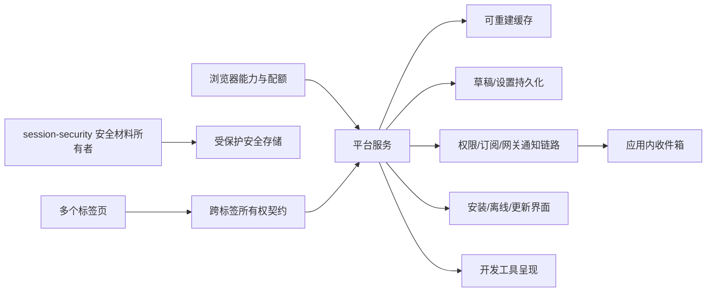

# Web 平台规格

**状态:** Draft（目标行为提案，未接线、未验证）
**版本:** 0.1（决策基线：D01–D03）
**受众:** 产品、Web 平台与存储工程、测试和评审；按浏览器操作和资源结果核对契约。
**范围:** 浏览器存储能力与配额、可回收缓存、跨标签页资源所有权契约、通知/推送链路、外观和开发工具平台呈现、PWA 安装/离线/后台及更新。
**治理:** 本域定义浏览器平台结果，不定义房间或成员行为、密钥信任/恢复、或消息发送重试。密钥存储安全与账户生命周期引用 [session-security §4](../session-security/spec.md#4-功能需求与接口契约)；成员关系引用 [rooms-spaces §4](../rooms-spaces/spec.md#4-功能需求与接口契约)；通知收件箱的消息动作由 conversation-ui 拥有；发送事务见 [message-delivery §4](../message-delivery/spec.md#4-功能需求与接口契约)。跨标签只规定谁拥有何种数据及旧所有者不得覆盖新所有者，不规定锁算法。Draft、Demo、空屏障不证明产品完整性。
**变更历史:** 从 `client-core/spec.md` 拆出平台、存储与通知路径；原图对相关行为的补充为作者提案，尚待用户审阅。

---

## 1. 背景与目标

### 1.0 设计图景

用户操作平台设置或启动网页/PWA。浏览器、平台服务和安全存储分别返回事实；界面只呈现结果。可重建缓存与凭据/加密密钥具有不同保护和清理规则。

```text
用户启动网页或已安装 PWA
|-- 浏览器读取会话与本地数据成功 -> 账户服务恢复当前账户并按其状态同步
|   |-- 在线 -> 显示在线状态和已知会话
|   +-- 离线且缓存可读 -> 显示缓存与离线状态，保留本地草稿但不伪称已同步
|-- 浏览器存储不可读/已清除 -> 显示本地能力状态，由账户与安全域裁决重试或重新认证；不推断服务端数据已删
+-- 离线且没有缓存 -> 显示尚无离线数据，网络恢复后再加载

平台服务读取存储使用量与能力
|-- 可用配额满足写入 -> 保存草稿、设置或可重建缓存
|-- 可回收缓存占用空间 -> 按缓存策略回收缓存并报告结果；不得回收草稿、待发送快照或密钥
|-- 配额查询失败 -> 显示容量未知，实际写入结果仍由数据所有者处理；不因缺少估算假称写入必然失败
+-- 实际写入空间不足且回收后仍不足 -> 拒绝该写入，保留已有确认数据并说明原因

用户在多个标签页使用同一账户
|-- 当前标签持有某账户同步/写入所有权 -> 仅所有者提交其拥有的跨标签任务
|   |-- 所有权交接确认 -> 新所有者接管；旧所有者停止写入并丢弃迟到结果
|   +-- 另一个标签仍持有所有权/交接失败 -> 本标签显示只读或等待状态，不重复执行任务
+-- 标签关闭或崩溃 -> 平台协调恢复可用所有权；不把旧标签迟到结果写入新代状态

用户启用通知或后台推送
|-- 仅启用本页系统通知 -> 浏览器请求通知权限
|   |-- 获准 -> 当前页面可按通知规则展示；不声称后台推送已启用
|   +-- 拒绝/能力缺失 -> 保留应用内收件箱，说明本页系统通知不可用
|-- 用户启用后台推送且权限获准 -> 平台建立浏览器订阅、配置推送网关并向 homeserver 注册对应 pusher
|   |-- 订阅、网关配置与服务端 pusher 均确认 -> 显示设备推送已启用，不保证系统后台常驻
|   +-- 任一环节失败 -> 显示失败环节，保留应用内收件箱；授权本身不当作推送成功
+-- 用户停用或撤销权限 -> 停止本机投递，尝试注销对应订阅/pusher；注销未确认时显示待清理状态

用户查看通知收件箱、声音/邮件、全局或房间规则、关键词或屏蔽名单
|-- 读取成功 -> 显示对应来源确认值；选择通知转交会话交互域定位
|-- 修改获对应服务端/本机设置所有者确认 -> 更新确认值；屏蔽不当作服务端踢出成员
+-- 读取/修改失败或取消 -> 保持最后确认状态与未保存输入，显示原因或返回

用户修改设备外观、声音或平台选项
|-- 值有效且存储确认 -> 应用设置并显示生效值
+-- 值无效、存储失败或用户取消 -> 保持最后确认值并说明未保存

用户打开开发工具查看事件或账户数据
|-- 读取授权且成功 -> 以不可执行文本展示结构，隐藏凭据与秘密
|-- 用户显式请求修改数据且授权有效 -> 交由对应数据所有者校验并提交
|   |-- 所有者确认 -> 显示确认后的值；不绕过原域契约
|   +-- 失败/拒绝 -> 保留原确认值与编辑，显示原因
+-- 读取失败/拒绝/用户关闭 -> 显示错误或返回，不产生数据变更

用户安装、离线使用或更新 PWA
|-- 浏览器提供安装能力且用户接受 -> 浏览器完成安装并显示启动入口
|   +-- 用户取消/浏览器拒绝 -> 保持网页可用并说明未安装
|-- 浏览器启动已安装 PWA -> 按普通网页路径恢复账户和缓存
|-- 新版本可用 -> 提示或按平台更新策略切换版本；切换前保留可恢复的本地数据
|   |-- 更新成功 -> 显示新版本已载入
|   +-- 更新失败/用户延后 -> 保持当前可用版本并显示待更新状态
+-- 浏览器不支持安装/后台能力 -> 网页仍可用，不显示虚假按钮或能力
```

### 1.1 为什么写

浏览器配额、缓存、安全材料与后台权限的生命周期不同。用单一“本地数据”规则清理会丢失不可重建数据；将通知授权误当推送成功也会给用户错误状态。本规格将平台事实和数据所有者分开，并为配额不足、所有权竞争、推送失败和更新失败定义用户可观察后继。

### 1.2 目标

- GOAL-1：写入受配额约束；只回收可重建缓存，配额不足时保留确认数据并报告失败；见 AC-001。
- GOAL-2：跨标签任务在任一时刻由明确所有者负责，旧所有者结果不能覆盖新状态；见 AC-002。
- GOAL-3：通知显示权限、订阅、网关注册各阶段真实结果，PWA 安装/更新失败不阻断网页使用；见 AC-003、AC-004。
- GOAL-4：外观设置和开发工具不暴露秘密或伪造保存成功；见 AC-005。

### 1.3 非目标（Out of Scope）

- 密钥、凭据、交叉签名、信任、导入/恢复和账户清理规则归 session-security。缓存 TTL、配额清理绝不清除或覆盖安全密钥。
- 跨标签互斥算法、锁租约实现及共享工作队列算法不在行为规格中；只定义所有权交接结果契约。
- 通知内消息内容解析与动作、房间成员邀请处理归 conversation-ui / rooms-spaces；本域拥有设备权限、订阅和推送网关注册结果。
- 消息发送排队/重试归 message-delivery；离线提示不更改其规则。
- 本规格不声称现有 Demo 已实现存储、推送、PWA 或多标签产品能力。

## 2. 术语表

| 术语 | 定义 | 禁止同义词 |
|---|---|---|
| 可重建缓存 | 可从服务端或再次处理取得的本地副本 | 密钥备份 |
| 安全材料 | 凭据、加密密钥及其恢复材料；由 session-security 管理 | 缓存 |
| 本地草稿 | 尚未提交且不可由服务端重建的用户输入 | 可回收缓存 |
| 跨标签所有者 | 当前被授权处理某账户某类共享任务的标签实例 | 浏览器全局锁 |
| 推送启用 | 浏览器权限与设备订阅、网关配置及 homeserver pusher 注册全部确认的设备状态；任一项失败/未确认均不是启用 | 通知权限已允许 |
| 更新待处理 | 新应用版本可用但当前版本仍在运行 | 更新完成 |

## 3. 系统模型与状态机

### 3.1 架构与边界



平台服务查询浏览器能力并向数据所有者交付结果。缓存回收只处理可重建数据；草稿和安全材料分别由各自所有者持久化，平台服务不能把它们当作缓存清除。跨标签所有权契约不指定锁算法、心跳、数据库或广播机制。

| 组件 | 输入与用户意图 | 状态所有者 | 失败观察与接收方 |
|---|---|---|---|
| 存储能力服务 | 浏览器用量/配额/写入结果；读取、写入 | 平台持有能力观测；缓存/草稿/安全所有者各持数据 | 配额不足返回明确失败；数据所有者保留已确认值 |
| 缓存回收器 | 空间不足与缓存可重建性分类 | 缓存服务仅持有可重建副本 | 回收后仍不足则拒绝写入；不得调用安全材料删除 |
| 跨标签协调器 | 账户与任务的所有权交接结果 | 当前所有者仅持有声明任务，平台协调所有者代际 | 竞争/交接失败使非所有者只读或等待；旧结果丢弃 |
| 通知/推送服务 | 浏览器权限/订阅、网关配置、homeserver pusher 注册/注销结果；启用/停用 | 平台服务持有设备推送状态；收件箱持通知内容 | 任一项失败/未确认均显示未启用；停用注销未确认显示待清理，应用内未读仍可用 |
| 外观设置服务 | 用户设备/账户偏好 | 对应偏好范围的设置所有者 | 写入失败恢复最后确认值 |
| 开发工具适配 | 经授权读取或显式变更意图 | 被查看/修改数据的原领域所有者 | 失败显示原因；敏感字段脱敏，文本不可执行 |
| PWA 生命周期服务 | 安装、离线、更新浏览器事实 | 浏览器控制安装/更新；平台保存 UI 状态 | 失败保持当前网页/版本可用，显示待处理原因 |

### 3.2 状态定义

本域未建立有限事件模型。平台对象包括可重建缓存与配额结果、账户任务所有者、通知各阶段结果、外观设置确认值及 PWA 更新状态。安全材料属于 session-security，不纳入缓存状态。未建 Haskell 模型或性质，不宣称 G7 通过。

### 3.3 状态转换

按 §1.0 的用户路径产生结果：配额不足先尝试回收合格缓存，仍不足则拒绝新写入；所有权交接只在新所有者确认后完成，旧所有者停止写入；通知逐阶段确认；PWA 更新失败维持当前可用版本。这里不规定实现层锁算法或密钥清理方式。

### 3.4 外部输入域矩阵

| 用户可达输入 | 成功结果 | 失败/取消结果 | 裁决所有者 |
|---|---|---|---|
| 启动在线/离线 | 显示可读账户数据及同步状态 | 无缓存则明确无法离线加载；不宣称数据已删 | 账户与缓存所有者 |
| 配额写入 | 保存至对应数据所有者 | 回收仅限可重建缓存；仍不足拒绝新写入 | 浏览器能力服务与数据所有者 |
| 标签竞争/交接 | 确认新所有者接管并由旧所有者停止 | 非所有者只读/等待；迟到结果丢弃 | 跨标签协调契约 |
| 开启推送 | 浏览器权限/订阅、网关配置与 homeserver pusher 注册均确认才启用 | 任一项失败/未确认不启用；显示失败环节，保留应用内未读 | 平台推送服务消费浏览器/网关/homeserver 结果 |
| 保存偏好/工具操作 | 被授权所有者确认变更后显示新值 | 保留旧确认值及未保存编辑 | 设置/目标数据所有者 |
| 安装/更新 PWA | 浏览器确认后展示已安装/已更新 | 网页/旧版本继续可用，显示未完成 | 浏览器与平台服务 |

## 4. 功能需求与接口契约

需求仅定义本域平台行为；成员、密钥、发送及会话 UI 行为按头部链接委托。

- REQ-001 配额与数据分类
  - **作为**使用浏览器客户端的用户，**我希望**存储不足时只清理可重建缓存并保留草稿与安全材料，**以便**释放空间不会丢失不可重建数据。
  - **优先级:** P0
  - **契约:** 每类数据由单一领域所有者管理；平台回收器只能请求可重建缓存释放空间。草稿、待发送快照及安全材料不得按缓存过期规则删除。此处安全材料保护语义由 session-security 唯一拥有。
  - **验收标准:** Given 配额不足且存在可回收缓存，When 写入被拒，Then 只回收缓存后重试该写入；Given 仍不足，Then 拒绝新写入、保留已确认草稿/安全材料并说明原因。
- REQ-002 跨标签所有权
  - **作为**同时打开多个标签的用户，**我希望**账户级共享任务只有一个已确认所有者，**以便**重复同步或旧结果不会覆盖当前状态。
  - **优先级:** P0
  - **契约:** 所有权身份至少区分账户、任务类型和所有者代际；新所有者确认接管后，旧所有者停止该任务写入，迟到结果不得应用。失败的标签只能显示只读/等待；本需求不规定锁算法。
  - **验收标准:** Given 标签 A 失去任务所有权且标签 B 已接管，When A 的迟到结果到达，Then 不改变 B 的数据；Given 所有权交接未确认，Then 新标签不并行提交该共享任务。
- REQ-003 通知与推送链路
  - **作为**希望接收后台通知的用户，**我希望**分别看到权限、订阅和网关注册结果，**以便**知道设备是否真正启用推送。
  - **优先级:** P1
  - **契约:** 本页系统通知与后台推送分开呈现；推送启用需要浏览器授权/订阅、网关配置与 homeserver pusher 全部确认。通知收件箱及规则/声音邮件/屏蔽名单只展示来源所有者确认值；任一步失败保留应用内通知，不声称后台已启用。具体网关与 SDK 版本映射仍待核验。
  - **验收标准:** Given 权限获准但网关注册失败，When 设置页显示结果，Then 显示未启用及失败阶段且应用内通知仍可用。
- REQ-004 外观偏好与开发工具平台呈现
  - **作为**用户或获授权开发者，**我希望**保存偏好或查看数据时看到确认值且不暴露秘密，**以便**能够安全配置与诊断。
  - **优先级:** P1
  - **契约:** 偏好保存失败恢复最后确认值；开发工具只以不可执行文本呈现并脱敏，显式修改由被修改数据的所有者授权和确认。
  - **验收标准:** Given 偏好写入失败，When 操作返回，Then 恢复旧确认值并保留错误；Given 事件包含令牌/密钥字段，Then 工具视图不显示其值也不执行内容。
- REQ-005 PWA 安装、离线与更新
  - **作为**浏览器用户，**我希望**在浏览器允许时安装、离线使用缓存并安全处理更新，**以便**浏览器拒绝能力时仍可继续网页使用。
  - **优先级:** P1
  - **契约:** 安装和更新以浏览器确认作为成功；离线状态明确缓存/未同步边界；更新失败或延后保留当前可用版本和本地数据，不把待更新表示为已完成。
  - **验收标准:** Given 浏览器拒绝安装或更新失败，When 用户返回应用，Then 网页/当前版本仍可用且显示未完成；Given 离线启动缓存，Then 不标记为已同步。

## 5. 错误模型

以下为本域目标分类，不是既有浏览器或服务端错误码映射。

| 类别 | 产生条件 | 用户观察 | 恢复/接收方 |
|---|---|---|---|
| 配额不足 | 写入超过浏览器可用空间，回收后仍不足 | 拒绝新写入，保留确认数据 | 存储所有者说明影响；用户可管理缓存 |
| 配额不可读 | 浏览器能力查询失败 | 不猜测剩余容量，写入按实际错误失败 | 平台服务呈现能力未知 |
| 缓存不可读 | 缓存损坏/权限撤销/本地数据清除 | 标明缓存不可用，不宣称服务端数据删除 | 缓存所有者重建；账户服务负责重新认证 |
| 安全材料不可用 | 凭据/密钥库无法读取 | 转交 session-security 的认证/恢复结果 | 不得按缓存清理或重置处理 |
| 所有权冲突 | 多标签竞争或交接未确认 | 非所有者只读/等待 | 协调器完成交接；无锁算法规定 |
| 旧所有者迟到 | 交接后旧任务响应到达 | 当前账户数据不变 | 平台协调器拒绝过期结果 |
| 权限拒绝 | 浏览器通知/媒体权限未授予 | 设备功能未启用及权限原因 | 用户可在系统设置调整 |
| 订阅/网关/pusher 未确认 | 设备订阅、网关配置或 homeserver pusher 注册失败/未确认 | 未启用并显示精确环节，保留应用内未读 | 平台推送服务核验/重试；停用时注销未确认显示待清理 |
| 设置保存失败 | 偏好持久化失败 | 展示上次确认值并提示未保存 | 设置服务重试 |
| PWA 更新失败 | 浏览器拒绝或更新资源不可用 | 当前版本保持可用，显示待更新 | 用户稍后重试 |

## 6. 非功能需求（NFR）

下列容量/保留值沿用原聚合的拟议预算，均未经批准、未测量；不是现有实现事实。实际浏览器配额因环境变化，不得把拟议上限覆盖成浏览器保证。

| 指标 | 拟议值（未批准、未测量） | 边界及超限行为 |
|---|---:|---|
| 可重建消息/媒体缓存保留 | 30 日 | 仅限可重建缓存；到期回收前不得波及草稿或安全材料 |
| 单房间本地消息缓存 | 10,000 项 | 达限后回收旧缓存或拒绝新缓存，不无界扩容 |

- 保留区分：用户未主动删除前，草稿和安全材料不受缓存 TTL 影响；用户清除本地缓存提示不得宣称删除服务端数据。
- 隔离：缓存与安全材料使用独立数据所有者和清理权限；本域不重新定义安全材料加密与恢复政策。
- 通知正确性：权限批准不是注册完成；后台通知不保证系统无限时长运行。
- 跨标签一致性：任务应表现为唯一确认所有者；不以指定锁实现作为用户行为要求。

## 7. 异常与边界条件

| 场景 | 系统行为 | 可观察结果 | 测试锚点 |
|---|---|---|---|
| 配额不足，存在缓存与草稿 | 只回收可重建缓存 | 草稿仍存在；写入成功或明确拒绝 | 未接线，未提供锚点 |
| 安全存储占用空间但缓存可清理 | 不触碰安全材料 | 缓存回收结果独立显示 | 未接线 |
| A 标签交接后迟到写入 | 拒绝旧所有者结果 | 当前所有者数据不变 | 未接线 |
| 通知授权成功但订阅失败 | 不宣称已启用推送 | 显示订阅失败，应用内未读仍可用 | 未接线 |
| 网关注册失败 | 保留订阅事实但总体未启用 | 显示网关环节错误 | 未接线 |
| 浏览器拒绝 PWA 更新 | 保留正在运行版本 | 显示待更新 | 未接线 |
| 开发工具打开含秘密数据 | 输出脱敏且不可执行 | 凭据/密钥值不显示 | 未接线 |
| 离线启动且缓存为空 | 不伪造内容 | 明确无离线数据 | 未接线 |

## 8. 验收标准

- AC-001 / 配额：配额充足、仅缓存可清理、清理后仍不足分别验证；缺少容量估算不等于实际写入失败；草稿、快照和安全材料不按缓存清理删除。
- AC-002 / 所有权：多标签交接、交接失败、旧所有者迟到结果均验证唯一所有者与过期结果不应用；不指定锁算法。
- AC-003 / 通知推送：仅本页通知不要求后台订阅；后台推送按权限/订阅/网关/pusher 逐环节确认；失败不伪成功，规则与收件箱转交各自所有者。
- AC-004 / 偏好工具：偏好保存失败恢复确认值；开发工具输出不执行输入并隐去敏感值；修改失败不伪造确认。
- AC-005 / PWA：安装拒绝、离线有/无缓存、更新成功/失败/延后都保留网页或当前版本可用。
- AC-006：Demo 或静态通知不能证明浏览器持久化、跨标签所有权、真实推送网关或 PWA 更新已实现。

## 9. 决策日志

| ID | 决策及来源 | 主要影响章节 | 验证规则 |
|---|---|---|---|
| D01 | 用户确认的原关键路径涉及账户会话、阅读、草稿与发送；平台只提供持久化与离线状态，不修改发送后继 | §1、§3–§8 | 发送事务所有行为跨引用 message-delivery |
| D02 | 用户要求浏览器/PWA、多端能力与存储/通知目标；具体平台操作分支由作者从原图提取并补足 | §1–§8 | 浏览器拒绝能力时网页继续可用；状态按各自所有者区分 |
| D03 | 存储配额、缓存预算、跨标签交接、通知链路、开发工具安全呈现与更新细节为作者提案；预算未批准未测量 | §1–§8 | 不以拟议数字或 Demo 宣称已验证；跨标签不写锁算法 |

## 10. 验证

- 本域没有 Haskell 有限事件模型，未建立机械语义；G7 未通过且不宣称通过。
- 本域 `tools/` 包含结构审计、负例与屏障；实际结果见 tools/README.md。无真实协议锚点，空屏障是 SKIP，不是产品通过。
- 需浏览器真实配额、多标签并发、通知权限/订阅/Matrix 网关及 PWA 生命周期运行证据后，才能核验产品行为；目前均未验证。
